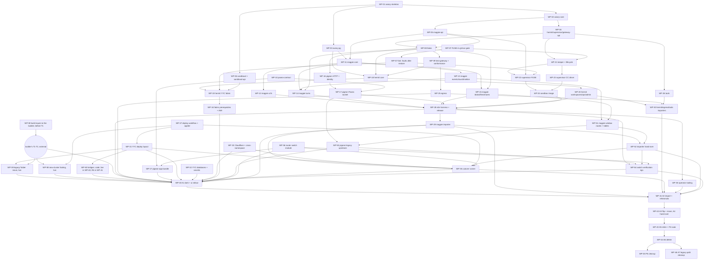

# YYC AI refactor: work packages

Companion to `/home/claude/artifacts/refactor/DESIGN.md` (the design) and the specs and notes it consolidates
(`spec-*.md`, `switch-final.md`, `deploy-workflows.md`, `pg-ha.md`; Deyao's decisions in `DECISIONS.md`). Each
package is sized so one implementer (a person or an agent session) can take it with no more than its listed inputs.
Contracts and shared crates come first; after they merge, the service packages run in parallel against the contract
crates and the in-process fakes, never against each other's half-built code.

Revised 2026-11-02 for Deyao's decisions: the switch allows only decision 11's reconnects and runs in working hours
(new switch-machinery packages WP-50, WP-51, WP-52, WP-54 and WP-56; WP-53 and WP-55 dropped by decision 11; WP-17, WP-27, WP-29, WP-35 and wave 3 changed; see the next paragraph for decision 11), deploys go through a GitHub workflow (new
WP-37, WP-39; WP-31, WP-35 changed), both Postgres clusters were to be highly available (WP-38, since dropped by decision 10; WP-32 changed), the
licence is AGPL-3.0-or-later (WP-01), the old chat UI's data is archived only (WP-44), auto-memory is per conversation
(WP-29, WP-52) and leavers are purged only by an operator (no package).

Revised again 2026-11-02 for decisions 10-12: the shared Cluster `pg` stays single-instance (WP-38 dropped; only
`magpie-pg` remains, in WP-32); the switch allows brief reconnects (DESIGN 9), so the router live patch (WP-53) and
the budget export (WP-55) are dropped, the old router gets a small switch module shipped by one ordinary ui rollout
(new WP-56), and WP-17, WP-27, WP-35, WP-36, WP-50, WP-51, WP-52, WP-54 and wave 3 shrink (DESIGN 9.11 lists what
went). A further attack round on DESIGN 9 the same day added the gated A1 rollout, the move's quiet rule, the
refusal of new old-path requests after the move, the T0→gate upload tee, the synchronous ingest on a miss, the
`restart` route for rollbacks and the pigeon HPA pin (WP-35, WP-50, WP-51, WP-54, WP-56 grow; effort table below).

Revised 2026-11-03 for decision 13 (DESIGN 15): the new stack lands on the new Talos cluster, planned by the session
"Kernel patches on K8s runners" (s4ba5e76eb6ec7ca4, now archived) and built by a session Deyao starts (**the builder**,
DESIGN 15), while the old stack stays on the old k3s cluster. New external dependency **T1-T2** (the builder's steps 1
and 2: control plane built and tested, first workers), which gates WP-59's live part and the whole operator phase
(WP-39, WP-40 onward), built with the inputs WP-59 hands over before T1 (DESIGN 15.2.1) and checked by DESIGN 15.2's
N1-N12. WP-39 is no longer the Flux
hand-over (dropped: the old cluster keeps Flux until it is removed) but the move of the old stack's folder to
`yyc-ai/legacy/` under that Flux. New packages: WP-59 (the new cluster's footing for YYC AI: deploy path, cluster-level
objects, readiness check) and WP-60 (the cross-cluster bridges). Changed: WP-19 (sandboxd's gateway mode keeps its
data plane across exits), WP-31, WP-32, WP-33, WP-34, WP-35, WP-36, WP-37 (retargeted; hand-over and gate code
deleted), WP-50, WP-52, WP-54, WP-56 and wave 3 (WP-40, WP-41, WP-44). Effort of decision 13 below the effort table.

## Conventions for every package

- **Repos and branches.** Commits go straight to `main` of the named repo (house rule); no force-push. aviary's
  `ci.yml` must stay green on every commit; a package that lands in pieces keeps each piece green.
- **Contract discipline.** The contract crates (`magpie-api`, `hermit-api`, `supervisor-api`, `gateway-api`,
  `sandboxd-api`) are the only coupling between service packages. A change to one after WP-04/WP-05 merge is its own
  small commit that updates the types, the golden fixtures and the fakes together; every dependent package picks it
  up from `main`.
- **Text of record.** Each package names its spec sections; where a spec still disagrees with another, DESIGN.md
  section 12 decides.
- **Done** means: code merged on `main`, the listed acceptance tests in CI (or recorded in the task record for live
  checks), docs in the repo updated, and nothing configuration-switched (the CI source rules of platform 4.5 pass).
- **Live work** (WP-39, WP-59, WP-40 … WP-46; WP-60's live part is inside WP-40 and WP-41) changes a cluster only through commits: on the new cluster
  applied by `yyc-ai.yml` (or, for its cluster-level and database objects, by that cluster's own workflow), on the
  old cluster by Flux (`yyc-ai` from `yyc-ai/legacy/`, `yyc-apps`, `yyc-db`); each new-cluster push is preceded by a
  plan against the live state; nothing by hand except where a runbook step says so (WP-39's `flux-sync.yaml`
  re-apply, `bridges.sh`, the runner's Flux suspend around the A1 gate). No live work of WP-39, WP-59 or WP-60, no
  node work on either cluster and no planned restart of Cluster `pg` happens inside A3-A5; WP-39 lands before A1 and
  WP-60's bridge server went up on 2026-11-05, before A1 (its checks wait for the callee Services).
- **Sizes**: S ≤ 3 implementer-days, M 4-8 days, L 2-4 weeks, XL more than 4 weeks (each XL lists how it splits if
  more hands are available).

---

## Dependency graph

Waves (everything in a wave can run at once once its arrows are satisfied):

| Wave | Packages | Gate to the next |
|---|---|---|
| 0 contracts and foundations | WP-01 … WP-10; WP-37 (YYC, no aviary dependency); WP-56 (claudecodeui, against the live router code, no aviary dependency) | WP-04 and WP-05 merged with fixtures; WP-07 gate verdict recorded |
| 1 services | WP-11 … WP-27; WP-51; WP-57 (the fork, from the WP-07 gate); WP-61 | every service's own suite green; conformance green for hermit and egress |
| 2 integration and switch tooling | WP-28 … WP-36; WP-50, WP-52, WP-54 | e2e E1-E24 green on `main`; importer tests green; legacy-in-a-box green on the commits A1 will deploy; YYC P1 layout renders identically for the old stack |
| Infra (before WP-40, never inside A3-A5) | WP-59's build inputs (to the builder before T1, through Deyao); WP-39 (live, after WP-31's layout is ready and T1-T2, decision 13); WP-59's live part (after WP-37 and T1-T2); WP-60's code (after WP-31; its bridge server is up since 2026-11-05, re-`up` in WP-40 step 2, and R6, its acceptance, runs in WP-41) | `kustomize build yyc-ai/legacy` equals the old render and Flux reads `yyc-ai/legacy/` with nothing changed; `talos-ready.sh` green; a no-op commit gives a green `yyc-ai.yml` run against the new cluster with an empty plan; `bridges.sh check` green and R6's probes pass |
| 3 execution (sequential, one operator session) | WP-40 … WP-46 | each phase's checklist (cutover 10, DESIGN 9.7) |

Critical path: WP-01 → WP-02 → WP-04 → WP-21 (with WP-07) → WP-22 (needs WP-05) → WP-24 → WP-28 → WP-29 → WP-52
→ WP-54 → WP-40 (which also waits for the builder's T1-T2, then WP-39, WP-59 and WP-60's code: whichever is later sets
WP-40's start) (the gated ui rollout waits for a moment with no running work on the old pods, E5, usually the first
evening; no upper bound, Deyao is told after 48 h, DESIGN 9.6) → WP-41 (a few days: bulk import, parity, R0, R1, R3,
R4) → WP-42 (one working afternoon). WP-07 (the FUSE gate) carries the largest technical risk and starts on day one.
Gone from the path: WP-53's live-patch verdict, the ≥ 7 working days of socket measurement in A2, the three-night
gate before A1, the hours-to-days A4 and WP-38's live work.

Build effort of the switch machinery beyond the base cutover plan (Claude working days, estimates; before decision 11
about 40):

| Piece | Package | Days |
|---|---|---|
| pigeon legacy upstream: LU client (socket and HTTP, newest-token rule, marker, the 401 sign-in answer), per-conversation routing with tickets and the 409 re-route, one replacement at release, the T0→gate upload tee, copy-at-send under the ticket, legacy view-as key, `/internal/switch/activity`, creates through LU for a rollback, request-free-first drain, counters | WP-50 | 5.5 |
| magpie window routes: outcome tickets, fence and fenced wait with lease, `import_uploads`/`uploads.legacy_path` resolution with a fresh copy per send and the synchronous ingest on a miss, the importer's `run_state` writes, release-time model and `name_source`, counters | WP-51 | 3.5 |
| importer hand-over: release rule with quiet period and full re-stat, gate checks over every ui pod from the API, running mirror, upload ingestion, warm hints, reverse export with shares, failed turns, titles and memory in the writer sidecar | WP-52 | 5 |
| router switch module (LU marker, request tracking with the 5 s quiet rule, opaque sockets, `sockets`, `move`, 503 before the 101 and the HTTP pass-on after the first move, `admit`, `restart`, in-flight HTTP counts, purge off) with tests | WP-56 | 4 |
| LU contract rig 2.5, persona rig 2 (with the attach-around-the-move and A1 personas), legacy-in-a-box 3.5 (stale edge, gated A1 rollout), fence-race and move fuzz and crash cases 1.5 | WP-54 | 9.5 |
| runner steps (`ui-rollout`, `ui-gate` and its deploy-job hook, `move` with the activity read, `old-connectors-0`, gate, `watch` counters and holders, the sequenced rollbacks) | WP-35 | 2.5 |
| chunk seeding from the ui pin history | WP-27 | 0.5 |
| rehearsals R0, R1, R3, R4 | WP-41 | 1.5 |
| saved from today's plan (pigeon 7.10 retry, `legacy.cut`, synthetic import turn, `final` release, `cut-old-connectors`, `wait-handover`, ui drain step) | — | −3 |
| **Net extra** | | **≈ 29** (5.5 + 3.5 + 5 + 4 + 9.5 + 2.5 + 0.5 + 1.5 − 3) |

Dropped against the previous estimate (≈ 16 days): the live patch (≈ 2.5, plus its rehearsal), the observer's
visibility tracking, fail-closed refusal, capacity, live config and reload hook (≈ 2), proxy sockets, presence, person
states and creates through LU (≈ 2), the seq remap, magpie-served legacy reads, timeline capture and the
zero-difference parity gate (≈ 4.5), the move rule with hold-downs and mobile exemptions (≈ 1), list-level LU
subscriptions and the whole-window eager tee (≈ 1; the T0→gate tee is back, in WP-50), the budget export with its migration (WP-55, ≈ 1.5), build determinism (≈ 0.5)
and the socket measurement (≈ 1).

Effort of decision 13 (Claude working days, estimates):

| Piece | Package | Days |
|---|---|---|
| new-cluster footing: the build inputs (DESIGN 15.2.1), `clusters/talos/` access, connector and CSI files, `talos-ready.sh` (N1-N12), the three cpx32, tofu on, deploy path bring-up (deploy-workflows 12.5) | WP-59 | 3 |
| bridges: `bridges.sh`, the bridge Services and policies on both clusters, R6's probes | WP-60 | 2.5 |
| applier and workflow retargeting, hand-over and gate code deleted | WP-37 | 1.5 |
| `legacy/` folder move under Flux | WP-39 | 1 |
| sandboxd gateway mode: leave-on-exit, adopt-on-start, sysctls; the gateway as a pod | WP-19, WP-34 | 2.5 |
| the runner on two clusters (Flux waits, the suspended-Flux gate, two-cluster patches, node-work hold) | WP-35 | 1.5 |
| importer through the old API (exec, pod proxy, kubeconfig), switch token header, LU and pass-on targets | WP-52, WP-56, WP-50 | 1.5 |
| legacy-in-a-box with two kind clusters and a bridge stand-in | WP-54 | 1.5 |
| saved: the Flux hand-over (H0-H4, seeding, adopt, the master restart) | former WP-39 | −2.5 |
| **Net extra** | | **≈ 12.5** |

---

## Wave 0: contracts and foundations

### WP-01 aviary repository skeleton (S)

- **Goal**: the empty but complete workspace every other aviary package builds in.
- **Repo, paths**: DE0CH/aviary: `Cargo.toml` (workspace, lints, profiles, `[workspace.dependencies]` pinned),
  `rust-toolchain.toml`, `.cargo/config.toml` (musl, rust-lld), `deny.toml`, `rustfmt.toml`, `LICENSE`
  (AGPL-3.0-or-later, decision 3; every crate's `license` field and the image label say so), `README.md`, `docs/CONTRACTS.md` (stub), `.github/workflows/ci.yml`
  (fmt, clippy, test, `cargo deny`, `cargo audit`, `gitleaks`), empty member crates.
- **Inputs**: platform 4.1-4.7, 6.1, 6.3.
- **Acceptance**: `ci.yml` green on an empty workspace; the source rules of platform 4.5 exist as tests (no
  `std::env::var` outside `aviary-core::env`; the name/dependency ban list over `crates/pigeon`, `crates/magpie`,
  `crates/supervisor`, `crates/*-api`; `jarvis`/`yyc` literals only in `crates/pigeon/src/paseo/compat.rs`) and fail
  on a seeded violation.

### WP-02 `aviary-core` (M)

- **Goal**: the service runtime shared by every binary.
- **Paths**: `crates/aviary-core/{env,log,ops,drain,auth,http,version}`.
- **Inputs**: platform 3.1-3.9, 4.3, 15.1.
- **Acceptance**: unit tests for: `env::required*` aborting on missing/empty; JSON log line shape and `redact()` on
  every string field (tokens, emails, URLs with credentials); `/healthz`, `/readyz` gates and draining, `/version`,
  `/metrics` with `<svc>_build_info` and `<svc>_draining`; drain hook ordering, per-hook deadlines, second SIGTERM;
  `Callers` constant-time compare with rotation lists and `wrong_caller`; error envelope serialisation; `Aviary-*`
  stripping middleware; request-id minting and forwarding; reqwest builder sets `User-Agent` and `Aviary-Protocol`;
  retry helper only on idempotent calls.

### WP-03 `aviary-pg` (S)

- **Goal**: Postgres pool, migrations, leader lock, LISTEN helper, the no-network-in-transaction rule.
- **Paths**: `crates/aviary-pg`.
- **Inputs**: platform 3.9, 4.3, 11.
- **Acceptance**: against a CI Postgres 17: migrations applied once under the advisory lock by two concurrent
  starters; an edited migration's sha mismatch fails start; `Leader` failover when the holder's connection dies;
  `Listener` reconnect wakes every waiter; the clippy `disallowed_methods` entry rejects a `reqwest` call inside
  `aviary_pg::tx` (compile-fail test).

### WP-04 `hermit-api`, `supervisor-api`, `gateway-api` (M)

- **Goal**: the contract types, route constants, protocol numbers, clients, `Server` traits and golden fixtures for
  hermit (all surfaces), the supervisor's :7070 and local socket, and the gateway.
- **Paths**: `crates/hermit-api`, `crates/supervisor-api`, `crates/gateway-api`.
- **Inputs**: hermit 3 (all routes and objects, `ReleaseReason` 13.13, token format 6.1), supervisor 15.4 and 13
  (agent.sock), platform 3.11, R18, R33-R35; DESIGN 12 D1, D5.
- **Acceptance**: every request/response/event type round-trips its fixture; no `_` in any serialised key; the
  `hst1.` token codec (sign with a test key, verify, expiry, source address, unknown kid) with property tests;
  clients compile against the route constants only; `docs/CONTRACTS.md` documents the endpoint names and the
  gateway contract for implementers of another hermit or gateway.

### WP-05 `magpie-api` (L)

- **Goal**: magpie's whole contract: person, sandbox and hermit/ops/admin surfaces, event kinds, `Row`/`RowItem`,
  changes, commands and payloads, reports, errors, limits that callers must know.
- **Paths**: `crates/magpie-api/src/{conversations,events,rows,live,changes,turns,sandbox,shares,files,uploads,ops,errors,client}.rs`, `fixtures/`.
- **Inputs**: magpie 7.1-7.6, 8.2-8.5, 8.9, 16, 17; pigeon 14.1; DESIGN 12 D3, D4.
- **Acceptance**: fixtures for every route of magpie 16 (including error bodies), every event kind, every RowItem
  variant, every change type and command type; both pigeon's and the supervisor's expected shapes (pigeon 14.1,
  supervisor 10-11) are covered by the same fixtures; snake_case appears only inside `cc.*` event `data` (Claude
  Code's own lines). `ErrorCode::OffsetMismatch`'s documented meaning excludes an identical-bytes write (magpie 6.6
  rule 0; changed by the WP-07 gate on 2026-11-02, doc only: no type or fixture change).

### WP-06 sandboxd into aviary, `sandboxd-api` (M)

- **Goal**: move sandboxd (with its history notes) and the host scripts from jarvis3 into aviary, extract its REST
  types into `sandboxd-api`, keep behaviour identical.
- **Paths**: `crates/sandboxd`, `crates/sandboxd-api`, `fabric/host`, `fabric/aws`, `fabric/gvisor-patches`,
  `images/sandboxd`; source jarvis3 `chat/sandboxd/**`.
- **Inputs**: hermit 13.2 (the changes are WP-19's), 14.1, platform R16.
- **Acceptance**: sandboxd's existing test suite passes in aviary's CI; a static musl binary in the release
  artefacts; the scripts' renames per hermit 14 done; jarvis3's copy untouched until P5.

### WP-07 FUSE-under-gVisor gate (M, starts day one)

- **Goal**: prove or refute, before the supervisor is built beyond a spike, that an in-sandbox FUSE server for
  `~/.claude` works under YYC's runsc with the real Claude Code binary.
- **Paths**: `crates/supervisor/spikes/fuse-gate` (throwaway), results in the task record and summarised in
  `crates/supervisor/GATE.md`.
- **Inputs**: supervisor 2 and 22 gate items 1-6, 9, 10; DE0CH/gvisor `precopy-20261021.2`; one AWS host of the
  current fabric (read the `yyc-ai` skill; no cluster changes).
- **Acceptance**: recorded results for: mount as root inside a running sandbox and uid 1000 I/O; Claude Code 2.1.304
  turn with append, torn-tail repair, tombstone rewrite, compaction rename; checkpoint `--migrate-to`/restore with a
  write blocked in the server; the fd held only by a keeper process; SIGKILL after `read(2)` with a journal;
  flock/fcntl locks; syscall inventory of the real binary; throughput and latency injection (50/500 ms). A negative
  result on any item stops WP-22 and goes back to the design with the measured fact (the contingency in supervisor
  9.4: non-history paths to local scope).

### WP-57 gVisor fork: faults after a restore (M, from the WP-07 gate)

- **Goal**: explain and fix, on DE0CH/gvisor, the two faults the WP-07 gate measured after a live migration: an
  in-sandbox process killed by SIGSEGV (about 1 in 12 migrations with requests held in the supervisor, Claude Code
  included) and a `read(2)` of `/dev/fuse` that leaves no whole request in a `MAP_SHARED` slot of a scratch-disk file
  (supervisor 22 "Open items", 9.9).
- **Paths**: DE0CH/gvisor (the fix, a new release); aviary `fabric/fuse-gate` (the reproduction), `fabric/host/setup.sh`
  `GV=` (the pin, with WP-34's AMI).
- **Inputs**: `crates/supervisor/GATE.md` item 3 and `fabric/fuse-gate/results/` (every run, the sentry debug logs of
  batch `d`); supervisor 9.3, 9.9, 16, 22; hermit 13 (migration).
- **Acceptance**: the cause named with evidence; on a fork release, `migrate-batch.sh` with the hold, both layouts:
  0 lost processes and 0 short reads in 100 runs each (at the gate's rate of 1 in 12, 0 in 100 happens by chance with
  probability 0.0002), with the matched control (`HOLD=2`) and a control that dirties about 125 MB of memory during
  the checkpoint without a hold (the gate measured that the hold itself makes the final round about 125 MB larger,
  so `HOLD=2` alone cannot separate the two) run alongside; at least one batch on a fabric-AMI host in the fabric's
  account; the gate's release pin moved. A fault shown to
  be the gate's own setup instead is recorded with the same evidence. WP-19's live migration (split c), WP-22's
  migration acceptance and WP-40 wait for this package.
- **Note (WP-57 as built, 2026-11-02)**: the fork's final pre-copy round left freed or zeroed pages with their old
  bytes on the target; fixed in DE0CH/gvisor `precopy-20261102.1` (the gate's pin, `host-setup.sh`; its regression
  test fails with the fix reverted). On the same two Hetzner hosts, tmpfs layout, run one after the other (not
  interleaved; the old batch's stop at 100 was chosen after 3 of its losses were seen), the old release lost a process
  in 4 of 50 hold-on migrations (1 SIGSEGV, 3 SIGABRT) and the new one in 0 of 150; that this bug caused the gate's
  faults is probable, not traced to a page. The fix's effect is shown for tmpfs only: no old-release scratch batch ran
  on the hosts of a new-release one (new release, scratch: 100 runs with the gate's comparison, 60 on production's
  stopped-time path). The short read was the scratch move's quick-check final delta (a write through a shared mapping
  does not change the mtime): the mechanism is reproduced, the end-to-end short read was not; the gate's
  `send-scratch` checksums its final delta, and sandboxd's final delta has used `--checksum` since aviary `eedfbda`
  (WP-19). Details: GATE.md "WP-57". Remaining for WP-40: the must-pass batch on fabric-AMI hosts in the fabric's
  account (WP-40's row; also the first scratch-layout evidence for the fix), `mig.sh`'s mapped-counter check on the
  fabric AMI and the `maxScratchMib` decision (WP-40's row), and moving the deployed release (hermit.json
  `fabric.runsc`, which `fabric/host/setup.sh` reads as `GV`; jarvis3's pin) to `precopy-20261102.1`. The gate's pin
  (`fabric/fuse-gate/host-setup.sh`, and `crates/sandboxd/tests/real-host/setup-host.sh`) is moved.

### WP-08 Test fakes (M)

- **Goal**: in-process fakes for unit and integration tests of every other package, plus the standalone fakes the
  harness needs.
- **Paths**: `testing/fakes` (`aviary-fakes`: fake-magpie, fake-hermit, fake-supervisor implementing the `Server`
  traits with scripted behaviour and fault injection), `testing/mock-model` (scripted Messages API + models route,
  request log), `testing/fake-tools`, `testing/fake-access` (JWKS, get-identity, token minting).
- **Inputs**: WP-04, WP-05; platform 7.4-7.6.
- **Acceptance**: each fake passes the fixtures of its contract crate; fault knobs (latency, 503 bursts, hold, drop
  connection) are exercised by their own tests; mock-model streams SSE byte-identically to a recorded real response.

### WP-09 Reference gateway and conformance suites (L)

- **Goal**: `test-gateway` (the reference implementation of the gateway contract) and `aviary-conformance` with the
  `hermit`, `gateway` and `model` suites, published in `ghcr.io/de0ch/aviary-testing`.
- **Paths**: `testing/test-gateway`, `testing/conformance`.
- **Inputs**: platform 3.11, 7.3, 8; hermit 24.1; WP-04, WP-08.
- **Acceptance**: `aviary-conformance gateway` passes against `test-gateway` and fails on seeded faults (a stripped
  header kept, hermit outage turning into 403, upload cap counting fixed names, drain cutting a stream);
  `aviary-conformance hermit` passes against fake-hermit; `model` passes against mock-model; JUnit output.

### WP-10 Paseo contract harness (M)

- **Goal**: the Node harness that validates every frame pigeon emits against every supported client build.
- **Paths**: aviary `testing/paseo-contract/` (`package.json` pinning DE0CH/claudecodeui Paseo packages at commits,
  lockfile, `clients.txt`, `validate-frames.mjs`), aviary `.github/workflows/clients.yml` (receives
  `repository_dispatch` and appends a client commit).
- **Inputs**: pigeon 1.2, 7, 18.1; inventory areas 2, 4, 14.
- **Acceptance**: validates a recorded frame log of today's live CloudCLI bridge without error (proves the schema
  wiring); a seeded invalid frame fails; `clients.txt` holds the live web build and the shipped iOS builds.
- **Note (WP-10 as built)**: `clients.txt` is sorted by commit time (`<commit> <kinds> <time>`); the newest Paseo line's
  schema is exported. ui images from before Paseo (claudecodeui commits older than 3968b730, 2026-10-26, with no
  `paseo/`) are listed as kind `web-legacy` when dispatched as `web`, and the validators skip them. The client SDK for
  drivers is `clientForCommit(sha)` in `lib/protocol.mjs`. `newestClient("web")` is the newest *listed* web build,
  not necessarily the deployed one (a build is listed before its deploy, a rollback serves an older one): a driver that
  needs the deployed build takes the commit from the ui pin in DE0CH/YYC as an input. Each client build is built and
  validated under the runtime its own `paseo/package-lock.json` resolves (zod, zod-aot, semver, ws, … installed per
  build from the lockfile), so clients on different zod versions coexist in one list. `clients.yml` has no concurrency
  group (GitHub drops pending runs of a group); parallel runs race, and a stale one re-dispatches itself; a dispatch
  may carry a list of builds (`{"clients": [{"commit", "kind"}, …]}`). See `testing/paseo-contract/README.md`.

### Deploy path and the old router (no aviary dependency)

### WP-37 Deploy workflow and applier (M)

- **Goal**: the path by which a push to DE0CH/YYC applies `yyc/deploy` (decision 1), built and tested; applied
  live by WP-39.
- **Repo, paths**: DE0CH/YYC `tools/yyc-apply/` (Rust: `check`, `plan [--trailers]`, `apply`, `seed --from-flux`,
  `snapshot [--compare]`, `adopt --from-manager`; inventory ConfigMap, deletion gate, apply order, rollout waits),
  `tools/yyc-apply/{connect.sh,gha-token.sh}`, `.github/workflows/yyc-ai.yml`, `.github/actions/{k8s-tools,yyc-apply}`,
  `infra/yyc-cluster-ca.pem`, `news-stream/deploy/cluster/{master-authn.sh, cluster.sh api-forward}` and
  `hetzner-k3s.yaml`'s `additional_pre_k3s_commands`, `news-stream/deploy/cloudflare/tofu/deploy.tf`,
  `news-stream/deploy/clusters/hetzner/{deploy-access,yyc-ai-access,juicefs-csi}.yaml`.
- **Inputs**: deploy-workflows 3-7, 9; platform 13; claude-env CLAUDE.md "GitOps" and "Deploy means zero downtime".
- **Acceptance**: deploy-workflows 6.6's tests green against a kind cluster in the `check` job (an unnamed removal
  fails before any write; inventory superset after a killed run; stale-run skip; SealedSecret `Synced` wait; a
  never-ready Pod turns the run red with the old Pod serving; field-ownership transfer from a fake
  `kustomize-controller`); `check` items 9-12 fail on seeded violations; no cluster credential anywhere in GitHub
  (only the Access service token in environment `yyc-ai`).
- **Revised for decision 13** (deploy-workflows 12.4; the applier and workflow exist in DE0CH/YYC): target the new
  Talos cluster (CA `infra/yyc-talos-ca.pem`, `NAMESPACES=yyc-ai,yyc-ai-fabric`, `ACCESS` from `clusters/talos/`,
  the fence `yyc-deploy/sealed-secrets-applier`); delete `seed`, `snapshot`, `adopt` and their tests, the
  gated-rollout support (`Deploy-Gated-Rollout`, the `ui-gate` hook, `GATE_WAIT_SECS`), `HANDOVER_EXCLUDE`,
  `ACCESS_PENDING`, `master-authn.sh` with its `hetzner-k3s.yaml` line and `cluster.sh`'s embedding, and `cluster.sh
  api-forward`; move `clusters/hetzner/{deploy-access,yyc-ai-access,juicefs-csi}.yaml` to `clusters/talos/` rewritten
  for deploy-workflows 12.2-12.3; add `check` item 13 (one cluster) and `yyc-ai/legacy/**` to the check job's paths.
  Acceptance (revised): 6.6's remaining tests green; item 13 fails on a seeded `jarvis` object; `git grep -n
  'seed\|adopt\|Deploy-Gated-Rollout\|master-authn\|api-forward'` in `tools/yyc-apply`, `.github/workflows/yyc-ai.yml`
  and `news-stream/deploy/cluster` empty.

### WP-56 Router switch module (M)

- **Goal**: the one old-side change the switch needs (DESIGN 9.6, D21), shipped in the A1 ui image by one ordinary
  rollout: recognise LU sockets, track outstanding requests per first-hop socket, report sockets per person, move
  sockets at a request-free instant, switch the old purge off.
- **Repos, paths**: DE0CH/claudecodeui `jarvis/router.mjs` (a marked "switch window" section, deleted with the router
  in A6): `x-aviary-lu` checked against `JARVIS_UI_LU_TOKEN` (constant-time) and stripped in `upstreamHeaders`; a
  bounded-prefix frame reader on the existing `socket.on("data")` and `usock.on("data")` taps, run after the pipe
  write inside try/catch, keeping only `type`, `requestId` and the time of the last inbound frame other than
  `client_heartbeat`/ping (a request id is cleared by its response or `rpc_error`); opaque sockets as DESIGN 9.6 (an
  extension in the 101, a lost continuation, a `requestId` beyond the prefix or a reader exception: busy for the
  socket's lifetime, never moved, reported, alerted); in-flight non-LU HTTP counted per person;
  `GET /__jarvis/sockets`, `POST /__jarvis/move[?person=]` (close only with no outstanding request, ≥ 5 s inbound
  quiet and a call under 10 s old, re-checked at the close; close frame 1012, then 2 s of reading that counts any
  request frame; the first call arms the 503 before the 101 for new non-LU upgrades and the pass-on of non-LU HTTP to
  `http://pigeon-bridge:8080`, the old cluster's bridge Service to pigeon on the new cluster, DESIGN 15.5 B2),
  `POST /__jarvis/admit` and `POST /__jarvis/restart?person=` (stops an idle child only) with token
  `JARVIS_UI_SWITCH_TOKEN` in header `x-jarvis-switch-token` (the importer calls `sockets` and `restart` through the
  old API server's pod proxy, which does not pass `Authorization` on; decision 13);
  `JARVIS_UI_PURGE=off` disabling the per-child Recently-deleted purge and `purgeWake`;
  `jarvis/test/router.test.mjs` cases with the fake CloudCLI.
- **Inputs**: DESIGN 9.3, 9.5, 9.6; switch-final 4.2 (the tap placement and frame reader only), 23 C9, C15 (reader
  cost); claudecodeui 3de3f5d8 `jarvis/router.mjs` (the live code: `#onUpgrade`, `p.sockets`, `forwarded`, `drain()`).
- **Acceptance**: bytes through the router identical with and without the module (recorded sessions: fragmented
  frames, pings, a 1 MB message, close frames); per-frame added latency p99 within 1 ms; a `move` closes every non-LU
  socket and never one with a request outstanding or an inbound frame in the last 5 s (a slow request delays its
  socket's close until answered); fragmented-message, continuation, beyond-prefix and reader-exception cases each
  make the socket opaque and `move` leaves it; after the first move a new non-LU upgrade gets 503 before the 101 and a
  non-LU HTTP request reaches a fake pigeon byte-identical; `restart` answers `busy` while a chat, hold or background
  task runs and stops the child otherwise; LU sockets recognised only with the right token and never moved; with `JARVIS_UI_PURGE=off` no purge runs and
  `purgeWake` never starts a child; the existing router suite unchanged and green.

---

## Wave 1: services

### magpie

Internal seam shared by WP-12 … WP-15 (defined in WP-11 so they can proceed in parallel): `events::append(tx,
conversation, kind, data, meta) -> seq`, which calls `rows::project(tx, &event)`; `changes::emit(tx, person,
change)`; `fanout::notify(tx, channel, key, head)`. WP-11 ships them with the schema; WP-13 fills `rows::project`.

#### WP-11 magpie core (L)

- **Goal**: the binary, schema, conversations, list, change feed, fan-out, callers, ops reads, jobs framework.
- **Paths**: `crates/magpie/src/{main,app,limits,auth}.rs`, `src/db/migrations/0001_init.sql` (every table of magpie
  4 including `migrating` and the import tables, expand-only), `src/conversations/`, `src/changes.rs`,
  `src/fanout.rs`, `src/jobs/` (leader lock, outbox runner skeleton, retention), `src/http/{conversations,creations,changes,ops}.rs`.
- **Inputs**: magpie 1-4, 7.6, 9, 14, 15, 16.1 (M1-M6, M12), 16.4, 17, 18; platform 3; cutover 6.4 (the
  migrating checks: no lease, jobs skip them; the window routes are WP-51's).
- **Acceptance**: magpie 20's tests for list, create (idempotent), rename, delete/restore/delete for good, change feed
  (dense head, `latest`, 410 after retention, join without loss), fan-out across two replicas (a write on one wakes a
  long-poll on the other within 50 ms; a dropped LISTEN connection loses nothing), readiness rule (Postgres down
  after start keeps `/readyz` 200, requests 503), drain (held polls answer at once), the 409 path.

#### WP-12 magpie Claude Code state (`ccfs`) (XL)

- **Goal**: the store behind the supervisor's FUSE layer: file kinds, line storage with extraction, classification
  of the main transcript, the rewrite algorithm (truncate, rename-over, set-aside, limbo, retract), byte files,
  directories, the lease, the write path's durability, quotas, errno codes, resync.
- **Paths**: `crates/magpie/src/ccfs/{scan,extract,classify,lines,limbo,pages,reconstruct,lease}.rs`,
  `src/http/sandbox_cc.rs`, blob staging writer (`src/blobs/staging.rs`).
- **Inputs**: magpie 5.2, 6 (all), 16.2 (lease, cc routes), 17; supervisor 9.1-9.5; WP-11 seam.
- **Acceptance**: magpie 20's ccfs suite: byte-exact reconstruct of every fixture transcript after any sequence of
  appends, truncates and renames (property test against a local-file oracle); Claude Code 2.1.304 fixture run
  (compaction, tombstone, subagents) produces no duplicate and no missing event; lease rules (`not_current_sandbox`,
  `lease_lost`, hermit unreachable → 503); `opId` replay; a write whose range already holds the same bytes is a
  no-op success (magpie 6.6 rule 0, from the WP-07 gate's resend after a checkpoint); offset mismatch and resync; quota → 507; p50 ≤ 15 ms for a
  10 KiB append and p99 ≤ 150 ms for a 1 MiB image line with synchronous replication (CI with a 2-node Postgres).
- **Split if staffed**: (a) lines/pages/dirs + lease + write path; (b) classification + rewrite algorithm + limbo.
- **Carried (recorded deviation, review round 3)**: the 2.1.304 fixture run is met as a replay of the gate's final
  files; the real binary through a FUSE supervisor, and an end-to-end stale append with `append=1`, are WP-28's and
  block magpie 20's release gate. Bucket down (6.13): on a replica without the blob in a cache, a write,
  truncate or overwrite that cuts a line whose blob has left staging, and a kind change on rename, answer 503 until
  the bucket is back (rule 0 over whole lines and appends do not need it; best effort: a blob is usually still in the
  uploading replica's recent-uploads cache (32 MiB LRU, blobs up to 4 MiB, apart from the read cache), so cuts there
  usually answer, but the uploader is whichever replica claimed the blob and the cache drops its oldest; the rest follows from 5.2 deleting the staged copy once uploaded).

#### WP-13 magpie events, rows and timeline (L)

- **Goal**: the projection of events into rows (rules 1-10), row seq and epoch, paging and long-poll (M9), prompts
  (M10), search, the live-frame receiving side.
- **Paths**: `crates/magpie/src/events/`, `src/rows/`, `src/live.rs`, `src/http/{timeline,sandbox_live}.rs`.
- **Inputs**: magpie 7.1-7.5, 16.1 (M9, M10, search, live); pigeon 14.1.18; R27, R36.
- **Acceptance**: every projection rule has a test from events to rows; `rowSeq` density invariant (property test);
  epoch changes only under rule 9; `tail`/`before`/`after` pages exact with `hasOlder/hasNewer`; long-poll answers
  within 50 ms of a commit and holds no DB connection; E6-style cost test (page time flat over 120 turns); a live
  frame for a non-active turn answers 409 `turn_not_active`.

#### WP-14 magpie turns (L)

- **Goal**: admission, the driver (hermit acquisition), the command queue, supervisor reports, heartbeats, the
  watchdog and availability tick, cancel, asks, agent-started turns, the hermit feed follower, the outbox to hermit.
- **Paths**: `crates/magpie/src/turns/`, `src/hermit/`, `src/http/{turns,sandbox_turns}.rs`, outbox items.
- **Inputs**: magpie 8 (all), 9.6 (release on delete), 15, 16.1 (M7, M8, M11), 16.2, 16.3; hermit 3.6; R8; WP-08
  fake-hermit.
- **Acceptance**: every state transition of magpie 8.1 with fake-hermit and a scripted fake supervisor; two sockets
  sending at once get one turn; driver takeover after a replica kill; `sandbox_busy`, `not_allowed`, `gone` mapping;
  15 min deadline; stop before delivery, during run, forced after 30 s; `transcript_pending`; heartbeat watchdog
  counts only magpie-available time; feed follower 410 recovery; outbox exactly-once with 404 as done; M3 with a
  first message (WP-11 answers 501 for it until this package): a repeat and 16 concurrent creates with one key
  return the same conversation and the same first turn (the `first_turn` repeat path).

#### WP-15 magpie blobs, uploads, files, sent files, shares, view-as, admin (L)

- **Goal**: everything magpie stores besides transcripts and turns.
- **Paths**: `crates/magpie/src/blobs/` (S3 store, uploader job, LRU, thumbnails, display and model copies, GC),
  `src/http/{uploads,blobs,files,sandbox_files,shares,viewas,admin,hermit}.rs`, `src/shares.rs`, `src/viewas.rs`.
- **Inputs**: magpie 5, 9.6-9.7, 10, 11, 12, 13, 15, 16.1 (M13-M17), 16.2 (blobs, sent files), 16.3, 16.4.
- **Acceptance**: upload limits and types (413, 415), EXIF rotation and the model copy bounds (2 000 px,
  3 932 160 bytes), 40 MP decode cap; staged blob served before upload; bucket outage keeps writes working up to
  2 GiB staged; GC never deletes a referenced or young blob; sent-file two-phase snapshot; files panel through
  fake-hermit workspaces; share freeze/view/continue/revoke and the soft-delete 404 rule; view-as audit row written
  before a viewed send; person purge from hermit; admin reads audited.

### pigeon

#### WP-16 pigeon HTTP surface and identity (L)

- **Goal**: everything pigeon does except the socket protocol.
- **Paths**: `crates/pigeon/src/{main,identity,http,static_files,shell,signin,viewas,ops,uploads,blobs,shares}.rs`,
  `src/paseo/compat.rs` (wire constants), `images/pigeon/Dockerfile`.
- **Inputs**: pigeon 1-6, 10, 11, 12, 13, 14.2-14.4, 16, 17.2-17.3; hermit H1-H4.
- **Acceptance**: pigeon 18.2's HTTP tests ported from `jarvis/test/router.test.mjs` (routing table order, path
  normalisation, signed-out shell, signed-in identity with two Access teams and JWKS rotation, not-allowed 403,
  view-as token mint/verify/expiry and the read-only gate, `/ops` forwarding admin-only, upload and download
  streaming with Range, blob URL signatures); drain tests (pigeon 18.3); no `jarvis`/`yyc` literal outside
  `compat.rs`.

#### WP-17 pigeon Paseo socket and live streaming (XL)

- **Goal**: the `/paseo-ws` protocol end to end: handshake, envelope, every client message, server pushes, the
  pure Row → PaseoRow mapping (ported tool-call mapper), timeline and change pollers, join logic, turn-event
  ordering by `timelineSeq`, backpressure, reconnect behaviour, strings; the seams WP-50 plugs into (a
  per-conversation owner switch on native sockets, per-socket subscription tracking, a drain that closes
  request-free sockets first).
- **Paths**: `crates/pigeon/src/paseo/{transport,handshake,dispatch,messages,pushes,mapping,strings}.rs`,
  `src/feeds/{timeline_poller,change_poller}.rs`.
- **Inputs**: pigeon 7, 8, 9, 13, 14.1, 18.1; WP-05 fixtures, WP-08 fake-magpie, WP-10 harness.
- **Acceptance**: pigeon 18.1's contract suite: every frame valid for every client in `clients.txt`; the mapping
  equals the old bridge's projection for the imported-conversation fixture set (render parity input); poller join
  without loss or duplicate; `turn_completed` after the last row; epoch change → one `agent.timeline.replacement`;
  slow socket closed with 1013 without slowing others; the drain closes request-free sockets first; throughput
  target 5 000 sockets / 2 000 frames/s per replica (benchmark recorded). No "being moved" sentence and no 409 retry
  exist (DESIGN 12 D14).
- **Split if staffed**: (a) transport, handshake, static messages, list and timeline; (b) send, create, stop, rename,
  delete, asks, view-as on the socket.

### hermit

#### WP-18 hermit core (L)

- **Goal**: the contract served by the YYC implementation, behind a `Fabric` trait so a fake fabric runs in CI.
- **Paths**: `crates/hermit/src/{main,config,catalogue,people,deployment,warm,sandboxes,feed,starts,janitor,tokens,sandbox_routes,supervisor_client,db}.rs`, migrations, `images/hermit/Dockerfile`.
- **Inputs**: hermit 3 (except 3.8 workspaces internals and 3.11-3.12), 4, 5, 6, 7, 9, 10, 11, 12, 19, 20, 23,
  24.1-24.2; WP-04, WP-09.
- **Acceptance**: `aviary-conformance hermit` green with the fake fabric; hermit 24.2's ported tests (state machine
  transitions, idempotent `PUT` from two clients → one sandbox, long-poll wake and timeout, feed order/`latest`/410,
  soft vs forced release honouring the supervisor's 409, `reserved_until`, catalogue validation and live reload,
  token keys and liveness answered without a DB connection, `SandboxSelf` ETag, secrets 404 `not_granted`, activity
  → busy/idle clock); start task resumes after a replica kill.

#### WP-19 hermit YYC fabric (XL)

- **Goal**: gVisor sandboxes on AWS behind the WireGuard gateway: sandboxd client, placement and packing (ported),
  scaler, EC2 launch/release/reconcile, host heartbeats and loss, network pushes (egress DNAT targets from
  EndpointSlices), live migration as a resumable task, image digests; the sandboxd changes; the gateway DaemonSet.
- **Paths**: `crates/hermit/src/fabric/{sandboxd,placement,packing,scaler,ec2,hosts,network,migrate,images}.rs`,
  `crates/sandboxd` (hermit 13.2 changes), `fabric/host`, `fabric/aws`, `images/sandboxd`.
- **Inputs**: hermit 13, 14, 24.3; WP-06, WP-18.
- **Acceptance**: ported `vm.test.ts` and `packing.test.ts`; scaler and reconcile against a fake EC2 and
  fake-sandboxd; host loss → `gone/sandbox_lost` within 10 s; migration resumes after a hermit restart; fabric
  acceptance on real hosts (hermit 24.3) is run in WP-40. From WP-57 (GATE.md "WP-57", the short read): sandboxd's
  final scratch delta while the sandbox is stopped (`crates/sandboxd/src/storage.rs` `sync_scratch(last = true)`)
  compares contents (`rsync --checksum`), because a write through a `MAP_SHARED` mapping to an already dirty page
  leaves the mtime unchanged and the quick check skips the file (the supervisor's journal, SQLite's `-shm`); tested by
  a migration in which a process inside the sandbox writes a counter through a shared mapping of a scratch file
  (the gate's `mapcount-mig.sh` check: no page reads back an older value on the target), and the added stopped time
  measured on a scratch of the production size (5 GiB limit). Split (c) is not done without it.
- **Note (WP-19 as built, 2026-11-02)**: `--checksum` on the final delta since aviary eedfbda; through sandboxd's API
  on two hosts (`crates/sandboxd/tests/real-host/`): quick check 3 of 3 migrations lost the mapped writes, checksum
  0 of 10; the added stopped time is about 3.2 ms per MiB of scratch in use (15.5-15.8 s at 4800 MiB, 5.9 s at
  2000 MiB, 129-139 ms near empty, against 129-147 ms with the quick check). A source its send stopped lists
  `alive: false`, and hermit's settle waits while the target's receive runs (spec 13.10 step 6). Item 6 on a real
  runsc: a killed sentry empties its cgroup, `alive:false` in 7.6-8.1 s; a memcg OOM inside the limit kills a
  systrap stub (the process inside exits 137, the sandbox keeps running, `alive:true`). The `hermit-gateway`
  DaemonSet manifest is WP-31's (`hermit/fabric.yaml`). Second review (2026-11-02): a source lists `sending` for its
  whole send and the settle waits on it; every wait of a receive is bounded in sandboxd (relay 900 s including its
  rsync connections and stream, restore 300 s after End) and the settle ends a migration 25 min after
  `migration_started_at` (`Timings::migration_limit`); `sandboxd check-config` validates the gateway's host.json
  before `gateway.sh` writes anything. **Decision for the owner of 13, due before WP-40 runs packing on real hosts:**
  keep the interim bound now in place (hermit moves no sandbox with more than `migration.maxScratchMib` 512 MiB in
  use, sandboxd's `scratchUsed`; about 1.7 s added stop at most) or narrow the checksum (e.g. the supervisor's journal
  via supervisor 9.9's `pwrite` fallback plus small or recently changed files, which must pass `mig.sh`'s mapped
  counter check). Chosen for now: the bound (spec 13.10 `movable`); spec 13.10's pause figure is corrected.
- **Split if staffed**: (a) sandboxd client, placement, packing, network pushes; (b) scaler, EC2, host loss; (c)
  live migration (its acceptance waits for WP-57 and includes the checksummed final delta above).

- **Decision 13** (DESIGN 15.6, hermit 14.2, 30): sandboxd's gateway mode runs as the main process of a host-network
  pod on a Talos node: it leaves `wg0`, its nft table, ip rules and routes in place on exit and adopts and reconciles
  them at start from `host.json` and the peer and egress sets it saves under `/var/lib/hermit-gateway`; it sets its own
  interface sysctls; no `gateway.sh` host install. Acceptance adds: `kill -9` of the gateway process while a test peer
  sends through the VIP loses no data-plane packet and interrupts :7443 only for the restart; a second start adopts
  without recreating `wg0` (its handshake times unchanged); a `host.json` missing a field leaves the running data plane
  untouched. Only if N7's test shows the CNI does not serve NodePorts on `wg0`: a second VIP port 10.202.1.1:5432 to
  `db/pg-shared`'s endpoints, pushed by hermit.
- **Note (decision 13 as built, 2026-11-03, aviary 6aae1e9d)**: sandboxd saves the peer set hermit pushes
  (`/var/lib/sbx/peers.json`, beside `egress-targets`; the pod mounts hostPath `/var/lib/hermit-gateway` there) and
  applies both at start; it undoes nothing at exit; it sets `rp_filter` loose on `wg0` and the private interface and
  clamps forwarded SYNs from `wg0` to host.json `gatewayMss` (1280). `images/sandboxd` runs sandboxd as its entrypoint
  (alpine with ip, wg, nft, sysctl, crane, tar, zstd); `fabric/host/gateway.sh` is deleted. Acceptance:
  `crates/sandboxd/tests/gateway/adopt.sh` (real ip/wg/nft in network namespaces; ci.yml runs it with the binary in
  `sandboxd-soak` and with the image in `build`): `kill -9` under traffic, 0 of about 1120 ICMP packets lost and a TCP
  connection through the VIP never stalls, :7443 back about 2.2 s after the kill (2 s of it the test's own wait),
  `wg0` ifindex and handshake time unchanged, nft/rules/routes/peers identical; a host.json without `podCidr`
  exits 1 and changes nothing under traffic; a deleted `wg0` comes back with the saved peers and egress target with no
  push. The second VIP port :5432 waits for N7's result (not built). The DaemonSet manifest stays WP-31's: its
  host.json carries `limits.cgroups: false` and the hostPath mounts at `/var/lib/sbx` (hermit 14.2). Also closed then
  (aviary dd67e754): a sandboxd restarted mid-send lists the source `sending` until the old checkpoint has exited
  (marker `<name>.sending`); past the migration limit a still-sending source is kept only once the target lists no
  receive; `movable` treats an unreported `scratchUsed` as not movable and sandboxd reads it at each listing.

#### WP-20 hermit workspaces, ops page, admin routes (L)

- **Goal**: JuiceFS workspaces (ensure with quota, entries, files with Range, clone, delete), the operator page and
  snapshot (both monitor contracts), the health verdict, budget display, admin routes with audit, console tails.
- **Paths**: `crates/hermit/src/{workspaces,ops,snapshot,health_verdict,admin,console}.rs`.
- **Inputs**: hermit 3.8, 3.11-3.12, 15, 16, 18; platform 15.3-15.4; magpie 16.4 (ops reads), egress
  `GET /v1/ops/summary`.
- **Acceptance**: workspace path rules (`openat2` beneath, symlinks inside only), clone after a `prepare snapshot`
  flush (DESIGN 12 D8), delete releases the sandbox first; ported `ops.test.ts` and `common.test.ts`; snapshot shape
  matches `ai_slim` and `ai_activity` field paths and types; non-admin 403; every admin call writes
  `admin_events`.

### supervisor

#### WP-21 keeper, process model, lifecycle (L)

- **Goal**: `supervisor-keeper` (PID 1), the supervisor's start sequence, persisted run state, memory guard,
  dockerd on demand, the :7070 server with health/state/lifecycle/exec, the lifecycle state machine, the hermit
  client (descriptor, activity loop), shutdown.
- **Paths**: `crates/supervisor/src/bin/{keeper,supervisor}.rs`, `src/{keeper,hermit,memguard,docker,state,limits}.rs`.
- **Inputs**: supervisor 4, 5, 15, 16, 19, 20; WP-04; WP-07 verdict; DESIGN 12 D1, D2, D5.
- **Acceptance**: keeper protocol tests (spawn, stdin at-most-once by `msg_id`, fd store, exits ring); supervisor
  restart re-attaches to a running child; health `ready:false` until leased and mounted; unforced release and pause
  answer 409 while busy; forced release ends the turn cleanly; clock-jump detection; memory guard picks the right
  victim on a fake `/proc`; RSS under 64 MiB in a soak.

#### WP-22 supervisor FUSE layer (XL)

- **Goal**: `~/.claude` over `/dev/fuse` without libfuse: init and dispatch, scope table (magpie vs local), node
  table, request journal for restart safety, write-through cache, the write path to magpie with retries and the
  stuck-op rule, errno map, resync, lease loop, locks.
- **Paths**: `crates/supervisor/src/fuse/{proto,dispatch,journal,nodes,scope,local,remote,cache,errno}.rs`,
  `src/magpie.rs`.
- **Inputs**: supervisor 2, 9, 19; magpie 6, 16.2; WP-05, WP-07, WP-21 (fd store), WP-08 fake-magpie; R26, R29.
- **Acceptance**: every FUSE opcode against both scopes; journal replay at each fault-injection point (supervisor 22
  item 4) with every syscall completing once and every write stored once; general outage blocks without EIO, one
  stuck op → EIO + `cc.write_stuck` after 10 min; offset repair from the cache; `lease_lost` and
  `not_current_sandbox` without a restart loop; supervisor 22 gate items 1-6 and 9-10 re-run on the real build.
  From the WP-07 gate (`crates/supervisor/GATE.md` "Design consequences", folded into supervisor 2.5, 9.3, 9.9,
  9.10, 22.4 on 2026-11-02): INIT replies 7.31; `bootId` per connection, stored atomically, and a start with a
  keeper fd but no readable stored id refused (9.3); the resend rule of 9.3 (keyed on the calling thread and the
  original's refused reply, never on INTERRUPT receipt), tested by a migration with a WRITE, a CREATE `O_EXCL`, a
  MKDIR and a RENAME in flight (each applied once, each caller gets the original result) and by a unit test in which
  the sentry stand-in resends without sending any INTERRUPT (as in the gate's `mig-s09`), both while the original is
  still in flight and after its reply was refused with ENOENT; the short-read check of 9.9; namespace operations
  answered from the tree where definitive. The migration acceptance waits for WP-57, and a migration through
  sandboxd (not the gate's `send-scratch`) also needs WP-19's checksummed final scratch delta (in aviary main since
  eedfbda, 2026-11-02): without it the journal slot of a request read during the stop can reach the target older
  than the restored `read(2)` says. The re-run of items 2 and 9 uses
  supervisor 6.1-6.4's argv, environment and managed files (the gate used `-p --dangerously-skip-permissions`).
- **Split if staffed**: (a) protocol, dispatch, nodes, local scope; (b) remote scope, journal, cache, repair.

#### WP-23 supervisor Claude Code driver (L)

- **Goal**: launching Claude Code (argv, constant env, managed files, tool and settings policy), the stream-json
  driver and run state machine, commands (`start_turn`, `interrupt`, `kill`, `answer_ask`, `title`, `stop_tasks`),
  reports, tasks and the hold, asks, uploads into `/workspace/uploads`, the user message, the SendUserFile hook over
  `agent.sock`, titles, `sandbox-secret`.
- **Paths**: `crates/supervisor/src/cc/{launch,managed,stream,control,run,tasks,prompt}.rs`,
  `src/{sent_files,uploads,model}.rs`.
- **Inputs**: supervisor 6, 7, 8, 10, 11, 12, 13, 14, 17; magpie 8.4-8.5, 11.2; WP-05, WP-21.
- **Acceptance**: supervisor 22's unit and integration list with a scripted fake `claude`: every run-state
  transition, start-turn-during-agent-turn race, supersede, cancel during hold, interrupt timeout, crash loop;
  command idempotency across a restart; reports never dropped across a 20 min fake-magpie outage; upload
  materialisation (symlink refusal, quota); hook fd passing; `--setting-sources=` ignores workspace settings (gate
  item 7).

#### WP-24 sandbox image (M)

- **Goal**: `ghcr.io/de0ch/hermit-sandbox:<sha12>` built in aviary with the supervisor and keeper of the same commit.
- **Paths**: `images/sandbox/` (Dockerfile, apt and docker wrappers, `reportlab-cjk.py`, `90sandbox`, sudoers,
  profile, `smoke.sh`); source jarvis3 `chat/sandbox/`.
- **Inputs**: hermit 17; supervisor 3, 22 (image smoke); platform 5.2.
- **Acceptance**: image smoke: keeper is the entrypoint (no tini), `claude` resolves to root-owned
  `/opt/claude-code/bin/claude` (2.1.304), a test gateway sees Claude Code's model and MCP calls as proxied
  `http://model/…` and `http://tools/mcp`, wrappers work, Docker on demand through the new socket; `/opt/agent`
  absent.

### jarvis3 and claudecodeui

#### WP-25 egress as YYC's sandbox gateway (L)

- **Goal**: egress implements the gateway contract and its own database, with today's internet rules and ZDR intact.
- **Repo, paths**: DE0CH/jarvis3 `chat/src/egress/**`, `chat/src/main.ts` (argv roles), `chat/test/egress.test.ts`,
  `.github/workflows/chat.yml` (conformance job), `chat/aviary.ref`.
- **Inputs**: platform 3.11, 17.2 egress items 1-11, 17.3, 13.6 (kept literals); WP-09 conformance image.
- **Acceptance**: `aviary-conformance gateway` and `model` green against the image under test; egress's own tests:
  pip/npm through the mirror self host with the proxy env, upload cap counts a CONNECT tunnel but not 40 MiB of
  fixed-name PUTs; DB outage keeps model requests answering with the last budget status and buffered log rows; drain
  bounds; the ZDR literals unchanged.
- **Relay** (decision 14): Deyao is its only user and it may be disrupted; WP-58 is not part of this plan.
  Kept: WP-58 below lands before A3. Dropped: WP-58 is not done, relay users are told before A3, and the relay's
  config and keys go in A6.
- **Open dependency** (WP-25 close): route MCP servers (DESIGN 10 "Route MCP servers", YYC's label store) are not on
  the new egress; WP-61 below carries them and lands before A3. Until then docs/CHAT.md "Known gaps" lists it.
- **Still open** (WP-25 close): chat.yml's conformance job builds `aviary-conformance` and `mock-model` from source
  at `chat/aviary.ref`; the switch to `ghcr.io/de0ch/aviary-testing:<sha12>` (platform 17.3) waits for WP-28 to
  publish that image.

#### WP-58 Relay on the new egress (M, after this plan, only if Deyao asks; decision 14)

- **Goal**: staff's own Claude Code reaches the model route through the new egress, as the old relay (jarvis3
  650f6ff) does: an egress-owned token table (the old `relay_tokens` rows carried over), an admin API to issue and
  revoke tokens, a pigeon page for a person's own token, the relay listener with the model route's ZDR, shortlist and
  budget, and the `ai-relay` tunnel route pointed at it.
- **Repos, paths**: DE0CH/jarvis3 `chat/src/egress/**` (a relay listener and migration), DE0CH/YYC `yyc/deploy`
  (`ai-relay` route), the pigeon page (repo per DESIGN 10).
- **Inputs**: DESIGN 10 "Relay"; YYC README "Relay"; WP-25.
- **Acceptance**: a carried-over token works through `ai-relay` to the mock model with ZDR forced and the budget
  applied, a revoked one is refused, and cutover 11.2's relay preflight check passes; lands before A3 (WP-42).

#### WP-62 Tools over REST and managed skills on the new stack (M)

- **Goal**: decision 15 on the new stack: Claude Code has no MCP servers; it calls `http://tools/v1/tools/<name>` (and
  WP-61's label store) with `curl`, taught by managed skills.
- **Repos, paths**: DE0CH/aviary: `gateway-api` (the `tools` fixed name routes `GET /v1/tools`, `POST
  /v1/tools/<name>`, `GET /v1/openapi.json` in place of `TOOLS_MCP`), `testing/fake-tools` (REST), the conformance
  suite's `route.tools` case and `fakes.rs`, `docs/CONTRACTS.md`; hermit's config (a skills folder) and descriptor
  (`managedSkills`, in the etag); `supervisor/src/cc/managed.rs` (skills written, no `managed-mcp.json`, GATE.md);
  `images/sandbox/smoke.sh` (Claude Code runs `curl http://tools/v1/tools/echo` through the proxy instead of
  `mcp__tools__echo`); a release, then DE0CH/jarvis3 `chat/aviary.ref` and `chat/src/egress/proxy.ts` `routed()` (the
  REST paths). DE0CH/YYC: the new stack's skills (the old stack's `yyc/deploy/skills` with the new stack's
  addresses: `http://tools/…` through the proxy, no `JARVIS_EGRESS_TOKEN`).
- **Inputs**: decision 15; jarvis3 adcd983 (tools REST, done); spec-supervisor "managed files"; spec-platform 7.6.
- **Acceptance**: conformance green with REST `route.tools`; the sandbox smoke's Claude Code calls a fake tool with
  `curl` and the call reaches fake-tools with the pair bearer and `Aviary-Sandbox-Person`; `/etc/claude-code` holds the
  skills and no `managed-mcp.json`; lands before A3 (WP-42).
- **Built** (2026-11-04): aviary 8b1338d3 (gateway-api REST `tools` paths, fake-tools REST, conformance
  `route.tools`/`route.tools-paths`, hermit `prompt.skills` → descriptor `managedSkills`, supervisor writes the skills
  and no `managed-mcp.json`, smoke via the `echo` skill's `curl`); jarvis3 egress `routed()` REST paths and
  `chat/aviary.ref`; YYC `yyc/deploy/hermit/skills/` (the old skills with `http://tools/…` and `http://labels/…`),
  ConfigMap `hermit-skills`, check_deploy item K. The skills ride hermit's descriptor (this package), not an image.

#### WP-61 The label store on the new stack: a sandbox route (M)

- **Goal**: Claude Code on the new stack reads and changes YYC's label store as on the old stack (jarvis3 0991254,
  docs/CLAUDE-CODE.md "Skills and sandbox routes"; DE0CH/YYC `labels/README.md`): the label store's REST API
  (`/api/v1`, decision 15) at a fixed name with the `yyc-labels-ai` credential injected, and the `labels` skill.
- **Repos, paths**: DE0CH/aviary platform spec 3.11 (a fifth fixed name `labels`, or a generic configured route kind:
  the implementer picks one and records it in the spec), the conformance suite's case for it, the supervisor's managed
  skills (the `labels` skill, from configuration so other deployments add none);
  DE0CH/jarvis3 `chat/src/egress/**` (the route in egress.json with `inject`, `allowPaths` and the conversation
  header the label store reads, `X-Jarvis-Conversation` from `Aviary-Sandbox-Conversation`), tests; DE0CH/YYC
  `yyc/deploy` (the route and the `yyc-labels-ai` keys on the new egress).
- **Inputs**: decision 15; YYC `yyc/deploy/config.json` route `labels`; WP-25; WP-62 (managed skills).
- **Acceptance**: from a sandbox on the new stack, `curl` to the label store's fixed name lists the designs and
  saves a design change at the fake upstream with the Access service token injected and the conversation header set;
  a path outside `allowPaths` (`/api/v1/` only) is refused; cutover 11.2's label store preflight check passes; lands
  before A3 (WP-42).
- **Built** (2026-11-04): the choice is a generic configured route kind (platform 3.11.8): aviary 8b1338d3
  (`gateway-api::routes`, test-gateway `--route`, conformance `route.configured`/`route.configured-paths` with
  `--route`); jarvis3 egress sandbox routes (egress.json routes beside model and tools with `allowPaths` and
  `identityHeaders`, log kind `route`, tests, its conformance job with `--route`); YYC egress.json route `labels`,
  egress env `LABELS_AI_CLIENT_ID`/`_SECRET` from Secret `egress` (infra/secrets.txt). The preflight check itself is a
  live check (cutover runner `record`) at A3.

#### WP-26 tools on the new contract (M)

- **Repo, paths**: DE0CH/jarvis3 `chat/src/tools/**`, tests.
- **Goal**: argv role, own config and catalogue path, only gateway bearers, owner from `Aviary-Sandbox-Person`,
  liveness from hermit, own database, server name `tools`.
- **Inputs**: platform 17.2 tools items 1-5; WP-04.
- **Acceptance**: tool calls carry `X-YYC-User: <email>` to a fake yyc-mcp; a `releasing`/`gone` sandbox is refused;
  hermit outage serves cached liveness; drain 150 s.

#### WP-27 `pigeon-app` bundle workflow (M)

- **Repo, paths**: DE0CH/claudecodeui `.github/workflows/pigeon-app.yml`, `scripts/build-paseo-ui.mjs` (unchanged
  behaviour), image `ghcr.io/de0ch/pigeon-app:<sha12>`.
- **Goal**: build the Paseo web export, keep hashed chunks of recent builds (30 days, last 5), seed with the chunks
  of **every** `yyc-ai-ui` image served within the 720 h Access session lifetime (the list from the ui pin history in
  DE0CH/YYC's git log, including the A1 image of WP-56) and add their commits to aviary's `clients.txt` (DESIGN 9.6),
  validate pigeon's frames, dispatch the commit to `clients.txt`. No build-determinism gate: the chunks are copied
  from the images.
  Note (WP-10): the seeded images pinned 2026-10-21 to 10-23 are pre-Paseo commits; dispatch them as `web` like the
  others, and `append-client` lists them as `web-legacy` (no protocol to validate). Send the whole seed list as ONE
  `paseo-client` dispatch, `{"clients": [{"commit": "<40 hex>", "kind": "web"}, …]}`, not one dispatch per image:
  runs of `clients.yml` race, and each extra run that loses redoes its work.
- **Inputs**: pigeon 17.1; cutover D13, 13; DESIGN 9.6; WP-10, WP-56 (its A1 ui image is among the seeded ones).
- **Acceptance**: a build produces the image; every file of each listed `yyc-ai-ui` tag's `/app/dist/_expo/static/**`
  is present byte-identical; the Expo patch assertion; chunk budgets; the frame validation step fails on a seeded
  incompatible frame. From A1 to A5 `pigeon-app` stays at the A1 claudecodeui commit (only a `pigeon-app`-only fix
  may ship).

### Switch machinery (DESIGN 9; deleted in A6, the legacy-path set in A7)

#### WP-51 magpie window routes and tables (S)

- **Goal**: magpie's part of the switch window (until A6) and the legacy-path set (until A7).
- **Paths**: `crates/magpie/src/legacy/` (tickets that close only on an outcome, fence and fenced wait with a 3 s
  lease, 409 `route: "legacy"`, `import_uploads` and `uploads.legacy_path` resolution in M3/M7 with a fresh upload
  copy per send and a synchronous ingest through the importer's `POST /v1/ingest-upload` on a miss before
  `unknown_upload`, magpie 8.2 step 4), the importer's `run_state` writes for migrating conversations (running mirror), the release-time
  model and `name_source` columns, migrations (expand-only), counters (`magpie_fence_seconds`,
  `magpie_unknown_upload_total{legacy}`, `magpie_conversation_migrating_total`, `magpie_legacy_path_total`);
  `magpie-api` types and fixtures. No anchors, seq maps, captured rows, presence or person state.
- **Inputs**: DESIGN 9.2-9.5; switch-final 4.3 (tickets, fence), 10.1 (resolution), 23 C5, C15 (fresh copy per send);
  A §3.2; cutover 6.4, 7.8; WP-11, WP-13, WP-15.
- **Acceptance**: every route of cutover 6.4's table; a send during a fence waits ≤ 3 s and becomes the first native
  turn; a fenced conversation whose lease lapses unfences; a legacy path resolves through both tables any number of
  times; a legacy path in neither table is ingested synchronously and resolves (a file attached at move − 2 s, sent at
  move + 3 s to a native conversation); the importer's `run_state` write shows in M1 and the change feed; retention keeps the legacy-path set after
  the A6 contraction (a migration test).

---

## Wave 2: integration and switch tooling

### WP-28 Integration harness, release pipeline (L)

- **Goal**: k3d harness with the real pigeon, magpie and hermit images, the real sandbox image as Pods created by
  `fake-sandboxd`, the reference gateway, mock model, fake tools and fake Access; scenarios E1-E24 gating every
  image push; images, labels, the `aviary-<sha12>` release, `nightly.yml` (soaks, Claude Code release gate).
- **Paths**: `testing/fake-sandboxd`, `testing/e2e` (k3d config, manifests, driver crate `aviary-e2e`), `testing/e2e-harness`,
  `.github/workflows/{ci.yml,nightly.yml}`, `images/*`.
- **Inputs**: platform 5, 6, 7; supervisor 22 soak and `claude-code-gate`; every service package.
- **Acceptance**: E1-E24 green on `main`; artefacts on failure (logs, events, admin dumps, frame log); images pushed
  only after the harness passes; release holds every static binary with `SHA256SUMS`; image labels carry
  provides/accepts protocol numbers. Carried from WP-09: push `ghcr.io/de0ch/aviary-testing` (built and smoke-run
  in ci.yml's `build` job, never pushed yet); its binaries are on PATH by name (the container command is
  `aviary-conformance gateway …`), not platform 5.2's argv[0] symlink entrypoint. Carried from WP-25: once it is
  published, DE0CH/jarvis3 chat.yml's `conformance` job runs that image at chat/aviary.ref's sha12 (spec 17.3) and its
  Rust build of aviary-conformance and mock-model is removed. Carried from WP-27: the first `aviary-<sha12>` release
  carries `pigeon-frames.ndjson` and `paseo-contract.tgz`, and the next claudecodeui pigeon-app run logs "pigeon's frame
  corpus and harness of DE0CH/aviary aviary-…" instead of the no-release warning (until then it validates only the
  harness's fixture frames, a recorded deviation from pigeon 17.1 step 5). Carried from WP-12: magpie 20's Claude
  Code fixture acceptance (2.1.304 with compaction, a tombstone and subagents: no duplicate and no missing event)
  as a run of the real binary against the mock Messages API through a FUSE supervisor and magpie, with person turns
  (each prompt the echo of its `user.sent`); WP-12 met it only as a replay of the gate's final files
  (`crates/magpie/tests/ccfs_claude_code.rs`). Also from WP-12: `cc/write` has `append=1` (409 `offset_mismatch`
  when the offset is not the file's size, magpie 6.10); the supervisor sends `append=0` today, and its appends and
  the repair's suffix writes should set it, with an e2e case of a stale append retried under a new `opId`. Both
  WP-12 items block magpie 20's release gate (the Claude Code release gate): no magpie release ships until the real
  2.1.304 run and the stale-append case pass here; WP-12 is complete only then (a recorded deviation of WP-12). Carried from WP-24: WP-24's Goal artifact,
  `ghcr.io/de0ch/hermit-sandbox:<sha12>`, exists only as `hermit-sandbox:ci` built inside ci.yml's `sandbox-smoke` job
  from `build`'s `dist` (never tagged `<sha12>`, exported or pushed; images/sandbox/README.md "Built in the smoke
  job"). Platform 6.1's `images` job builds it as `<sha12>` and exports the OCI tar that `sandbox-smoke` consumes
  (its own build step removed), the `gvisor` job runs that image under runsc, `e2e` uses it as the sandbox Pods'
  image, and `publish` pushes it only after those pass; WP-24's Goal is met only then (a recorded deviation of WP-24).

### WP-29 magpie importer (XL)

- **Goal**: `crates/magpie-import` linked into `magpie import …`: plan, run, catch-up, verify, holds (running sets
  from `holds.js` executed in ui pods), release `--force`, reset, parity, export (reverse, with shares, failed turns,
  titles and per-conversation memory), status; the display fixes applied once; the fence and release transactions
  (cutover 7.8). The hand-over loop itself is WP-52.
- **Paths**: `crates/magpie-import/**` (incl. `src/holds.js`), magpie's import tables (already in WP-11's schema).
- **Inputs**: cutover 6, 7, 14.2-14.3; magpie 19; DESIGN 12 D18; WP-11 … WP-15 (the importer writes through
  magpie's library, so imported rows equal live ones).
- **Carried from WP-51**: `release <id> --force` first closes the conversation's open tickets with
  `magpie::legacy::tickets::expire(pool, id, magpie::legacy::tickets::now(pool))` (an open ticket otherwise refuses the fence and the release for ever), then fences
  and releases. Every release (the forced one and WP-52's) calls `fence::release_in` inside its own transaction and,
  after the commit, `Released::record(&metrics)`: the import Deployment registers `magpie::legacy::Metrics` on its
  own `:9090/metrics` registry, the only place `magpie_fence_seconds` is observed (DESIGN 9.9's and cutover 10.3's
  A5 gate read it there; magpie serve's family stays empty).
- **Acceptance**: cutover 7.12's tests 1-4, 7, 8 and 9 (fixtures of CloudCLI schemas and JuiceFS trees: mapping,
  byte-exact verify, idempotent re-run, suffix rewrite after compaction, shares cloned not renamed, ownership checks,
  the export round trip with shares, failed turns and memory, leader lock); `plan` fails on an oversize line or an id
  conflict and reports memory files, which are copied into each of the person's conversations (decision 6).
- **Split if staffed**: (a) mapping, run, verify, catch-up; (b) fence and release transactions, holds, parity,
  export.

### WP-30 hermit, egress and tools one-off copies (M)

- **Repos, paths**: aviary `crates/hermit` (`import-jarvis`, `jfs-owner` Job command, `legacy-cleanup`,
  `fabric/aws/legacy-down.sh`); jarvis3 egress and tools `import-jarvis` argv commands.
- **Inputs**: cutover 8; hermit 15.4, 22.3; platform 17.2 egress item 6, tools item 5.
- **Acceptance**: idempotent by source id; `--delta`; share workspaces cloned to `ws/<uuidv5>` and skipped when
  present; `person` backfill rules; `legacy-cleanup` refuses without `--confirm` and keeps every `ws/` that magpie's
  `workspaces/exists` names.

### WP-31 YYC deploy layout (L)

- **Goal**: the P1 tree of `YYC/yyc-ai/deploy/` with the old stack moved unchanged under `legacy/`, every new
  manifest, ConfigMaps, NetworkPolicies, and the YYC checks as steps of `yyc-ai.yml`'s `check` job.
- **Repo, paths**: DE0CH/YYC `yyc/deploy/**` (platform 9.1 layout: no `namespace.yaml`, no `juicefs-csi.yaml`,
  both cluster-level from WP-37), `catalogue.json`, `hermit/{hermit.json, system-prompt.md, sandbox-rules.md,
  title-system.md}`, `egress/egress.json`, `tools/tools.json`, `jobs/` (suspended), the `check` steps of
  `.github/workflows/yyc-ai.yml` (render, platform 13.3 items 1-8, the render-parity diff), `yyc-ai-zdr.yml`,
  `yyc/tests/test_zdr.py`, `yyc/infra/openrouter.py`; the window pieces of cutover 10.1 commit 7 prepared.
- **Inputs**: platform 9, 10, 13; hermit 9, 21; cutover 10.0-10.1, D15-D18; deploy-workflows 6.6; WP-37.
- **Carried from WP-51**: magpie requires `MAGPIE_TOKEN_IMPORT` at start (P1 to A6) and the import Deployment's
  `export-server` accepts it as `MAGPIE_IMPORT_ACCEPT_MAGPIE` (platform 3.7's pair table, 9.5, 12.2,
  `YYC_TOKEN_MAGPIE_IMPORT`); Service `magpie-import` 80 → the sidecar's 8080 and the `magpie-out` rule to it from A3.
  The WP-28 e2e manifests set the token too.
- **Acceptance**: `kustomize build` filtered to the old stack equals today's render byte for byte, and
  `yyc-apply plan` against the live cluster shows only creates (no update in `jarvis`, an empty prune set); the
  `check` job enforces no behaviour config on pigeon/magpie (and nothing for the supervisor), one aviary sha, fitting labels,
  `hermit catalogue-check`, `catalogue.json` users/admins equal `config.json`'s while both exist; the rewritten ZDR
  guard passes and catches its three seeded mutations; prepared switch and teardown patches apply cleanly.
  From WP-27's review (design gap): the pigeon Deployment's pod-level ephemeral-storage limit covers the app bundle
  emptyDir. kubelet counts a disk-backed emptyDir against the sum of the containers' ephemeral-storage limits (the
  larger of the init and app phases), so platform 9.4's 128Mi on the pigeon container evicts a pod whose
  initContainer copied the 320-480 MiB bundle: the pigeon container gets a request and limit above the emptyDir's
  512Mi plus its own use (e.g. request 576Mi, limit 640Mi), or the emptyDir becomes `medium: Memory` with a matching
  memory limit; a `check` step asserts it. pigeon-app's 480 MiB budget assumes this.
  Also from WP-27 (design gap 4 in claudecodeui scripts/pigeon-app/README.md): platform 9.4's 32Mi memory limit on
  pigeon's initContainer is too low: `/cp` of the real 328 MiB tree was OOM-killed (exit 137) at 32, 64 and 128 MiB on
  GitHub's runner (kernel 7.0 azure) and copied at 256 MiB (at 32 MiB on a Hetzner host, kernel 6.8), since cgroup v2
  charges the copy's dirty page cache to the container. The initContainer gets a memory limit of 512Mi, the emptyDir's
  size (`CP_MEMORY_MIB` in claudecodeui `.github/workflows/pigeon-app.yml`, which CI checks the copy within); a `check`
  step asserts it.
  Also from WP-27 (design gap 1, the seeds' growth): seeds are mandatory and never pruned. Measured 2026-11-03 at
  YYC's ui pin rate (55.9 MiB of new files in 5 days since the chunk split, with about 260 MiB of pre-split seeds
  staying until 2026-11-29 11:44), the mandatory part is projected to pass 480 MiB in mid-November and peak near
  651 MiB, so pigeon-app builds would fail on the budget until late November. Before A1 either the emptyDir
  `sizeLimit`, pigeon-app's `--budget-mib` and the ephemeral-storage (or memory) limits above are sized over the
  projected peak that the pigeon-app run prints (its `::warning::`), or A1 waits until that projection stays under
  the budget (WP-35).
  From WP-19's review (the gateway DaemonSet's owner): `hermit/fabric.yaml` (platform 9.1) is this package's, as hermit
  14.2 lists it: DaemonSet `hermit-gateway` in `yyc-ai-fabric` (nodeSelector `hermit.yyc/gateway: "true"`, privileged,
  `hostNetwork`, `hostPID`, tolerations all, PriorityClass `serving`, RollingUpdate `maxUnavailable: 1`; initContainer
  `install` from `ghcr.io/de0ch/sandboxd:<sha12>` (aviary `images/sandboxd`: `/opt/hermit-gateway/{gateway.sh,
  sandboxd, crane, jq}`) running `nsenter -t 1 -m -u -n -i -- /opt/hermit-gateway/gateway.sh` with `SBX_HOST_JSON`
  pointing at the mounted ConfigMap; main container `busybox:1.37.0` with the readiness probe of 14.2), ConfigMap
  `hermit-gateway` with every `host.json` field 14.2 lists (sandboxd refuses to start without `name`, `wgAddress`,
  `hostCidr`, `controlCidr`, `sandboxCidr`, `egressVip`, `privateGateway`, `podCidr`; `gateway.sh` checks them first),
  Secret `yyc-ai-fabric/hermit-gateway` wired to `/etc/sbx/tls/{ca.crt,host.crt,host.key}` and `/etc/sbx/wg.key`, and
  the `hermit-overlay-route` DaemonSet (hermit 21.1); a `check` step asserts the ConfigMap has those fields.

- **Decision 13** (DESIGN 15.4, 15.7; platform 25): the tree is `yyc/deploy/` with the new stack only (no
  `legacy/`, which WP-39 moves to `yyc-ai/legacy/`); `bridges.yaml` (WP-60's new-side objects); generator
  `legacy-kube-ca`; every Deployment, DaemonSet and the gateway pinned to nodes in network `yyc` (label `yyc.hetzner/network=yyc`,
  fsn1 preferred), egress required in fsn1, `magpie-pg` in one location, two-replica spreads `DoNotSchedule`, all
  asserted by `check`; pigeon and hermit with a 12 s `preStop` sleep (DESIGN 15.5 R6); hermit's API egress a
  `CiliumNetworkPolicy` `toEntities: [kube-apiserver]` (DESIGN 15.2 N3); the gateway DaemonSet runs sandboxd itself (hermit 14.2: no
  `install` initContainer, no `nsenter`, hostPath `/var/lib/hermit-gateway`, 256Mi, readiness TCP 10.202.0.1:7443);
  database URLs and `metaurl` name `pg-shared.db`, `HERMIT_JUICEFS_META_URL` `<gw private IP>:30433`; hermit's
  API-server rule names the new endpoints; `yyc/yyc-catalogue` stays in `yyc-ai/legacy/catalogue/` (with the Flux
  load-restrictor check of DESIGN 15.4). The acceptance's old-stack render equality is WP-39's; here: the render has
  no object in `jarvis`, `kube-system` or `flux-system` (`check` item 13).

### WP-32 YYC databases and secrets (M)

- **Repo, paths**: DE0CH/YYC `news-stream/deploy/db/postgres.yaml` (roles, `Database` CRs `hermit`, `egress`,
  `tools`), `news-stream/deploy/db/magpie-pg.yaml` (Cluster `magpie-pg` with database `magpie`, decision 2: magpie
  18.2 plus pg-ha 4 — `failoverQuorum: true`, `pg`'s image, `pool=apps`, priority `serving`, ScheduledBackup
  `magpie-pg-nightly` 03:15 HKT, `magpie-pg-ingress` by selector, DESIGN 15.8), `pg-dump-daily.yaml`, `yyc/deploy/sealed/`
  (including the window keys of platform 12.2-12.3), `infra/seal.py` (`A|B` lists), `infra/secrets.txt`; store
  `yyc` keys via `scripts/store-put.py … --explain`.
- **Cost**: `magpie-pg`'s three 10 GB volumes, EUR 2.0592 a month with VAT (EUR 1.716 net).
- **Inputs**: platform 11, 12; pg-ha 4; cutover 10.1 commits 1, 3 and 7.
- **Acceptance**: every pair token and binding of platform 12.2-12.3 exists in the store with its explanation and is
  sealed into the right Secret; a dry-run unseal in CI resolves every key a manifest references; no secret value in
  git; `magpie-pg` 3/3 on three `pool=apps` nodes with `quorum` sync states and its first base backup in
  `yyc-pg-pitr/magpie-pg/` (in WP-40).
  Carried from WP-12: `magpie-pg`'s `postgresql.parameters` set `min_wal_size: 1GB` and `max_wal_size: 2GB` (a
  required parameter: magpie 6.10's p99 <= 150 ms for a 1 MiB image line was measured at these, 47-53 ms; at
  Postgres's defaults, 80MB / 1GB, new 16 MiB segment files cost 150-200 ms each and the p99 was 129-134 ms; see
  DE0CH/aviary `crates/magpie/README.md` and `testing/ci-services`). A manifest test in DE0CH/YYC's CI
  fails unless `magpie-pg.yaml`'s `spec.postgresql.parameters` has exactly `min_wal_size: 1GB` and
  `max_wal_size: 2GB` (or larger), so the setting the latency bound depends on cannot be dropped silently.

- **Decision 13** (DESIGN 15.8-15.9): `magpie-pg.yaml` goes to the new cluster's database folder
  (`news-stream/deploy/clusters/talos/db/`, its workflow), with `magpie-pg-ingress` by selector (the instances, the operator, magpie and the importers; DESIGN 15.8),
  `pg-dump-magpie` and `pg-shared.yaml` (selector-less NodePort 30433, target port 30432, manual EndpointSlice
  `pg-shared-manual` to 10.0.0.2:30432 with `managed-by: yyc-manual`); `postgres.yaml`'s roles and databases
  `hermit`, `egress`, `tools` stay on the old cluster with `pg-ingress` gaining 5432 from 10.0.0.0/16 and keeping its
  10.244.0.0/16 and 10.201.0.0/24 rules (no `magpie-pg` exclusion; a `check` step shows the commit's `pg-ingress` diff
  adds only); `infra/seal.py` picks the cert by folder and `--check` refuses a mismatch; the new stack's
  Secrets are sealed with `infra/sealed-secrets-talos.pem`, `ui-env` and the role passwords with the old cert; store
  key `YYC_OLD_CLUSTER_IMPORT_TOKEN` (made in WP-40 step 7). Acceptance adds: `seal.py --check` on a seeded wrong-cert
  file fails; `magpie-pg` 3/3 on three nodes in one location of the new cluster; a connection to `magpie-pg` from an unlabelled pod in `yyc-ai` refused.

### WP-33 Cloudflare and cross-namespace changes (M)

- **Repo, paths**: DE0CH/YYC `news-stream/deploy/cloudflare/tofu` (tunnel `pigeon`, test host, the switch block, the
  teardown block), `news-stream/deploy/apps/yyc-mcp.yaml` (ingress from `yyc-ai`), capture route ingress,
  `pg-ingress` (10.202.0.0/24), `news-stream/monitor.py` (hermit snapshot, `HERMIT_OPS_TOKEN`).
- **Inputs**: platform 14, 15.5; cutover 9; hermit 21.4-21.5.
- **Acceptance**: `tofu plan` of each block shows exactly the intended diff; the monitor reads both `ai_slim` and
  `ai_activity` from a recorded hermit snapshot; the switch block is a patch file in WP-35, not applied here.

- **Decision 13**: yyc-mcp's and the capture route's ingress admit `10.0.255.1/32` (bridge `yyc-bridge-old`)
  instead of `yyc-ai` pod selectors (the new tools are on the other cluster), with their bridge NodePorts (WP-60);
  `pg-ingress` as WP-32; the monitor's hermit URL names `yyc/hermit-bridge` (B4) until the monitor moves; tofu
  `deploy.tf` is WP-59's.

### WP-34 Fabric prerequisites, AMI, gateway node runbook (M)

- **Repos, paths**: aviary `fabric/host` (`gateway-net.sh`, `make-certs.sh`, `gateway-maintenance.md`),
  `fabric/aws/infra.sh`; DE0CH/YYC `.github/workflows/hermit-ami.yml`, `news-stream/deploy/cluster/cluster.sh`
  (skip nodes labelled `hermit.yyc/gateway=true`).
- **Inputs**: hermit 14; platform 13.5.
- **Acceptance**: AMI bakes from the pins in `hermit.json` and records its id; the AWS identities are least-privilege
  (policy diff reviewed); `cluster.sh` refuses the gateway node outside the runbook; the runbook script works against
  hermit's admin routes in the harness.

- **Decision 13** (hermit 14.2, 14.7, 30): `gateway-net.sh` targets the new cluster's gateway node (route
  10.202.0.0/15 → `<gw private IP>`, Hetzner firewall udp 51821 on that server, node label through the Kubernetes
  API; no node shell); `cluster.sh`'s gateway guard is replaced by the Talos upgrade workflow's call of
  `hermit-admin.sh gateway-maintenance --node-work …` and its node-work hold (DESIGN 15.2 N8, the Talos session's
  workflow; this package supplies the runbook entry point and the hold's file format); acceptance adds the runbook
  driving a fake node-work command against the harness.

### WP-35 Cutover runner and patches (M)

- **Repo, paths**: DE0CH/YYC `yyc-ai/cutover/` (Rust binary `cutover`: `freeze-check` (binds commits whose parent
  has `window.json`), `ui-rollout` (pushes `08-ui-rollout` once both old pods have had no running work for 10 min),
  `ui-gate` (run by `ui-rollout` from the session against the old cluster with Kustomization `yyc-ai` suspended,
  after Flux applied the Deployment paused: the switch busy route's running/processes/preparing/pending of every
  CloudCLI child by exec, never connections (DECISIONS E5), resume, pause before an old pod's SIGTERM if work appears, `a1_rollout_cut_total`; then `09-ui-unpause` and
  the Kustomization resumed; DESIGN 15.3), `preflight` (with the
  token-expiry list), `start-handover`, `flip` (with the HK-vantage probe, the settle time and the pigeon HPA pin),
  `move [--person]` (arm, then per person by pigeon's activity, until the gate), `old-connectors-0`,
  `allow-handover [--person]`, `watch` (state every 5 s, the zero counters, what each open conversation waits for and
  its owner, `hold on` and Discord on any non-zero), `retire-old`, `import-done`, `probe`,
  `rollback flip|conversation|old-up` (each in the order of DESIGN 9.10), `status`),
  `yyc-ai/cutover/patches/{05,08,09,10,20,30,40,50,51}-*.patch`, `yyc-ai/cutover/window.json` (added by `08-`).
- **Inputs**: cutover 11, 14, 16; DESIGN 9.6-9.10; deploy-workflows 10.2 (the runner waits on `yyc-ai.yml` runs and
  the inventory, never on a Flux reconcile); WP-29, WP-31, WP-33, WP-37, WP-52, WP-56.
- **Carried from WP-51**: `import_control.rollback_at` (DESIGN 9.10 step 1) is not in magpie's migrations; the
  package that first writes or reads it (`rollback flip` here, pigeon's creates through LU in WP-50) adds it as a
  magpie expand migration.
- **Acceptance**: every subcommand resumable from `~/artifacts/cutover/state.json` (killed mid-step and re-run in a
  test); patches apply with `git am --check` on current `main`; `freeze-check` refuses each frozen path on a seeded
  commit and passes the commit that adds `window.json`; `freeze-check` refuses a change of the `pigeon-app` `newTag`
  in `yyc/deploy/` between A1 and A5 unless the new tag's claudecodeui commit differs from the A1 commit only in
  `scripts/pigeon-app/` and `.github/workflows/pigeon-app.yml` (DESIGN 9.6; from WP-27's review), shown on a seeded
  commit of each kind; such a fix is a commit on a claudecodeui `pigeon-app-fix/<name>` branch cut from the A1
  commit (pigeon-app.yml builds those branches and refuses one that changes anything else; main itself moves on), so
  the rule compares the new tag's commit with the A1 commit, not with main; before A1's pins are pushed the runner
  checks claudecodeui `scripts/pigeon-app/a1-ready.sh <A1 commit> <DE0CH/YYC clone>` (the A1 pigeon-app image exists,
  seeds its own ui image and every ui image served within 744 h at the time of the check) and that the latest
  pigeon-app run's seed projection stays under the budget (WP-27 design gap 1; otherwise A1 waits or WP-31 resizes); `ui-gate` keeps a fake rollout paused while a fake old pod
  shows a client connection, a child or a running set, and pauses it again when one appears before the second
  SIGTERM; `move` skips a person with a recent warm call or upload, keeps running after `old-connectors-0` until the
  gate, and lets `old-connectors-0` go only after 60 s of zero non-LU sockets and zero in-flight non-LU HTTP on every
  pod (a fake switch module); `rollback flip` refuses to revert the DNS while an owned conversation exists; `watch` holds fences on a seeded non-zero counter; `rollback
  conversation` and `rollback old-up` rehearsed in WP-41 against the test host.

- **Decision 13** (DESIGN 15.3, cutover 11.1, 23): old-cluster patches (`08-`, `09-ui-unpause`, `20-`, `30-`, `40-`,
  `51-import-done-old`, the A6 teardown) wait on Flux Kustomization readiness through `cluster.sh ssh`, new-cluster ones
  on `yyc-ai.yml` and the inventory; `ui-rollout` suspends Kustomization `yyc-ai`, runs `ui-gate` from the session and
  resumes it after `09-`; `preflight` sets `"nodeWork": "hold"` in `window.json` and, in the same commit, `suspend:
  true` on the builder's Descheduler CronJob (A5's commit clears both; DESIGN 15.2 N8), and checks `bridges.sh check`,
  R6 and B7; `watch` alarms on bridge health; `freeze-check` covers `yyc-ai/legacy/**` and either cluster's node config in
  A3-A5. Acceptance adds: a fake Flux Kustomization drives the wait; `ui-gate` refuses to start while the
  Kustomization is not suspended; `freeze-check` refuses a seeded node-config change between A3 and A5.

### WP-36 Operator tooling and docs (M)

- **Repos, paths**: claude-env `.claude/skills/yyc-ai/SKILL.md` (rewritten: names, runbooks, rollback, ops, costs,
  the deploy path: `gh run watch`, `yyc-apply plan --trailers`, `Deploy-Prune` trailers; Postgres operations:
  `magpie-pg`'s planned switchover, the single `pg`'s planned restart outside working hours),
  ported probes (A20.F17-F21) as scripts, the trace-by-conversation script, `hermit-admin.sh`; aviary
  `docs/HARNESS.md`.
- **Inputs**: pigeon 18.4; hermit 16, 25; platform 15.2, 15.6.
- **Acceptance**: every probe runs against the harness and against the test host in WP-40; the skill describes the
  present only (no history).

- **Decision 13**: the `yyc-ai` skill describes two clusters for the window (which commits go through Flux, which
  through `yyc-ai.yml`, the bridges and `bridges.sh`, the operator paths to each cluster, the gateway pod and its
  runbook on Talos) and, after A6, one.

### Switch machinery (DESIGN 9; deleted in A6, the legacy-path set in A7)

### WP-50 pigeon legacy upstream (M)

- **Goal**: pigeon fronts the conversations the old stack still owns, with nothing read-only, cut or lost (DESIGN
  9.3-9.5).
- **Paths**: `crates/pigeon/src/legacy/` (LU WebSocket and HTTP to `http://ui-legacy:8080`, the new cluster's
  bridge Service to the old ui, DESIGN 15.5 B1, as the person with the newest
  verified Access token, `x-aviary-lu` marker, never reopened for a person whose token expires within the window;
  native sockets with per-conversation routing: a legacy conversation's timeline, live stream and writes through LU,
  writes under tickets, the 409 re-route; one `agent.timeline.replacement` per subscribed socket at a release or a
  reverse; uploads under the old route's limits while any conversation is legacy: from T0 to the gate written into
  the old child through LU's upload route and recorded in magpie with `uploads.legacy_path` (the old path returned),
  from the gate into magpie only and copied into the old child under the send's ticket for a legacy conversation
  (ticket first, then copy, then send; native with the magpie ids if the fence won); legacy view-as verification and
  re-signing; shares routed by where they live; LU 401 answered with the signed-out contract;
  `GET /internal/switch/activity`; creates through LU while `import_control.rollback_at` is set), the
  request-free-first drain (kept after A6), the counters of DESIGN 9.9.
- **Inputs**: DESIGN 9.2-9.5, 9.9; switch-final 4.1 (the LU connection), 3.2 C4-C5 (token rule, marker), 11
  (view-as), 23 C17; pigeon 7, 8; WP-17, WP-51 (and a fake old router from WP-54's rig).
- **Carried from WP-51**: every ticket call of a send carries its `clientMessageId` (a retry after a timeout then
  gets the open ticket, not a second one, while it is younger than `magpie_api::legacy::TICKET_REUSE_MAX`, 30 s;
  past that the repeat gets a new ticket). No legacy write starts later than the answer's `holdMs` after pigeon
  SENT the ticket call (its monotonic clock, never `issuedAt` against its own clock): past that, take a new ticket.
  Every ticketed legacy write is aborted when the old child has not answered within
  `magpie_api::legacy::TICKET_WRITE_TIMEOUT` (20 s); magpie's importer expires a stranded ticket on those bounds
  (`TICKET_SETTLE_MAX`). The old stack does not de-duplicate a send by `clientMessageId` (claudecodeui
  `paseo-hub.ts` `send` refuses only while a turn runs): an answer with `supersedes: {ticket, settleMs}` means the
  first write may have reached the old child, so pigeon waits `settleMs` from when it sent that call, reads the old
  child (running list, `pendingUserMessages`, the timeline's user message with that `clientMessageId`), and sends
  under the new ticket only when the first send is absent; when present it reports the new ticket's outcome from
  what the old child shows and answers the send as accepted. A test sends, kills pigeon before the report, repeats
  past 30 s, and the old child gets exactly one turn. Only a send's ticket call carries a `clientMessageId` (any other kind is 400): each attached file's upload
  ticket is a ticket of its own, reported `applied` on its own.
- **Acceptance**: against the LU contract rig: every write to a legacy conversation accepted once, none refused; a
  running old turn streams to its end through LU and Stop ends it; a file uploaded between T0 and the gate returns an
  old path that a fake old-path socket's send delivers to the old child; a file uploaded after the gate reaches an old
  turn and a pre-move asset path reaches a native one; a copy-at-send whose ticket loses to the fence sends natively
  with the magpie ids; an LU 401 gives the signed-out answer, not a write error; one replacement per subscribed socket at release and none before; the
  1 000-send fence-race fuzz through pigeon; a pigeon replica killed with LU sockets: tabs resume and LU reopens; the
  drain never closes a socket with a request outstanding while others are request-free; no `jarvis`/`yyc` literal
  outside `compat.rs` and `legacy/`.

### WP-52 Importer hand-over (M)

- **Goal**: the hand-over loop of cutover 7.5 and DESIGN 9.4: release only idle conversations once the old path is
  gone, never cut anything.
- **Paths**: `crates/magpie-import/src/{handover,preverify,fence,gate,mirror,uploads,warm,reverse,export_server}.rs`
  (the export server also answers `POST /v1/ingest-upload`, magpie's synchronous ingest on a miss; the gate also
  requires zero in-flight non-LU HTTP and no opaque socket; from the gate warm calls of legacy conversations are
  hermit hints only and no tickets; the reverse waits for an idle old child and calls the router's `restart`).
- **Inputs**: DESIGN 9.2-9.5, 9.10; switch-final 8.1, 23 C5, C9, C14.1-C14.3, C15 (warm, superseded transcripts,
  memory); A §3.3, 7, 13.2; cutover 6.3, 7.3-7.10, 14; WP-29, WP-51, WP-56.
- **Carried from WP-51**: the export server answers `POST /v1/ingest-upload` behind Service `magpie-import` (80 →
  the sidecar's 8080) with `MAGPIE_IMPORT_ACCEPT_MAGPIE` (platform 3.7's pair table, 9.5, 12, network `magpie-out`);
  a ticket whose outcome never arrives is closed with
  `magpie::legacy::tickets::expire_settled(pool, id, read_started)`, `read_started` = `tickets::now(pool)` (the
  database clock) taken right before an old-child read (running list, `pendingUserMessages`/`preparing`) that showed
  nothing for the conversation; it expires what was issued more than `magpie_api::legacy::TICKET_SETTLE_MAX` (90 s)
  before that, superseded tickets included, and the hand-over pass calls it for every migrating conversation with an
  open ticket on every pass (otherwise a superseded ticket whose outcome never comes holds the conversation legacy); the release calls
  `fence::release_in` last in its transaction, after the upload-ingestion pass, and records the answer with
  `Released::record` after the commit on the `magpie::legacy::Metrics` the import Deployment registers on its own
  `:9090/metrics` (WP-29's note); a test shows a release of the hand-over loop counted there, and the acceptance
  includes a check that the import Deployment's `:9090/metrics` shows `magpie_fence_seconds_count` rising after a
  release (in R1, against the deployed importer). magpie no longer reads
  `import_control.all_owned_at` (every miss is ingested until A6); if the importer keeps it, the reverse hand-over
  (cutover 14.2) clears it when it reopens a conversation. This package also owns cutover 7.12
  item 6's fence-race cases (WP-54 the move fuzz).
- **Acceptance**: cutover 7.12 items 5, 6, 7 and 9; ui pods enumerated from the API including Terminating ones; a
  stale or missing switch-module report, or one with a non-LU socket, keeps the gate unset; a ticket closed on
  delivery but not on an outcome keeps the conversation legacy; the quiet period and every fingerprint (cc files,
  sessions row, sent files, failed turns, uploads, shares) are re-checked inside the fence; leader `kill -9` between
  fence and release; the running mirror follows the running sets within one pass; a memory file copied into each of
  the person's conversations at import and at release (decision 6); the writer sidecar exports shares, failed turns,
  titles and per-conversation memory and reopens `import_sources`.

- **Decision 13** (DESIGN 15.5 B7, cutover 7.2): the importer reaches the old ui pods through the old cluster's API
  (`https://10.0.0.3:6443`, kubeconfig from `MAGPIE_IMPORT_LEGACY_KUBE_TOKEN` and the `legacy-kube-ca` ConfigMap):
  pod list and watch with Terminating pods, `pods/exec` for `holds.js`, `pods/proxy` for `/__jarvis/sockets` and
  `restart` with `x-jarvis-switch-token`; its LU reads through `ui-legacy` (B1). Acceptance adds: an unreachable old API
  keeps the gate unset and fences none (fail closed).

### WP-54 Switch verification rigs (L)

Size: 9.5 days (effort table), all of it switch machinery with no base part; above M's 8 days, so L at its low end.

- **Goal**: the proof that nothing is read-only, cut or lost (DESIGN 9.9) before anything touches staff.
- **Repos, paths**: aviary `testing/lu-rig/` (the ui image of the A1 commit with WP-56, a fake old web, a fake old
  sandbox agent with the mock model), `testing/legacy-in-a-box/` in `nightly.yml` (kind, the old stack at live pins
  with jarvis3's Kubernetes provider, an edge stand-in for the DNS change, every persona of DESIGN 9.9), the ownership
  property tests and the crash cases in `ci.yml`; DE0CH/claudecodeui the instrumented web build behind a test-only
  flag and the Playwright persona drivers (draft and attachment kept across a reconnect and a replacement, a send in
  flight at a move, at most one reconnect per move, an upload after T0 on an unmoved old tab sent on the old socket, a
  file attached at move − 2 s and sent at move + 3 s to a pigeon-born conversation, a tab open during the A1 rollout
  reconnecting at most once, no turn cut); the move fuzz (sends, Stops and steers at random instants around a move with real
  network delay: each accepted exactly once or still in the composer); a stale-edge stand-in after the move; the counter wiring check (every zero counter exists and is
  exported).
- **Inputs**: DESIGN 9.9; switch-final 15.3 (fuzz and crash cases); WP-28, WP-50, WP-52, WP-56.
- **Decision 13**: legacy-in-a-box runs two kind clusters (old and new) joined by a TCP proxy standing in for the two
  bridges (B1, B2) and a NodePort for `pg` (B3); the importer reaches the old one's API through B7; a
  persona case kills the bridge proxy's target node mid-run and every write still lands once.
- **Acceptance**: legacy-in-a-box green on the commits A1 will deploy, with every persona; a seeded defect for each
  zero counter (an in-flight close, a refused write, a cut old turn, an unknown legacy upload, a migrating 409 reaching
  a tab) turns it red; the persona rig catches a seeded lost draft and a seeded second reconnect.

---

## Infrastructure track (live; any time before WP-40, never inside the switch window)

### WP-39 `legacy/` folder move under the old cluster's Flux (S, live)

- **Goal**: the old stack applied by Flux on the old cluster from `yyc-ai/legacy/`, so `yyc/deploy/` holds only the
  new stack, with no live object changed (decision 13, DESIGN 15.4). Replaces the Flux hand-over, which decision 13
  drops: the old cluster keeps Flux until the builder removes it.
- **Depends on**: WP-31 (the layout); T1-T2 (decision 13 starts the operator phase, "WP-39/40 onward", only after
  them, although the move itself touches only the old cluster).
- **Repo**: DE0CH/YYC; live work in a session with `cluster.sh` access to the old cluster.
- **Steps**: `prune: false` on Kustomizations `yyc-ai` and `yyc-ai-secrets` (`flux-sync.yaml`, `cluster.sh flux`); a
  commit adds `yyc-ai/legacy/` as a copy of today's `yyc/deploy/` (with `sealed/`, `config.json`,
  `system-prompt.md`, `sealed-secrets-rbac.yaml`) and moves every `config.json` reader (tofu `access.tf`,
  `cloudflare.yml`, `mcp-image.yml`, `catalogue.test.ts`, `yyc-ai-ami.yml`, `openrouter.py`, the ZDR guard) to the new
  path; a `check` step shows the two renders byte-identical; `flux-sync.yaml` paths to `./yyc-ai/legacy` and
  `./yyc-ai/legacy/sealed` and its include line, re-applied; both Kustomizations Ready at the new revision; a commit
  deletes the old copy; `prune: true` again; `infra/seal.py`'s folder table and docs say `yyc-ai/legacy/sealed/`.
- **Inputs**: DESIGN 15.4; platform 25.2; `news-stream/deploy/clusters/hetzner/flux-sync.yaml`.
- **Acceptance**: the render check green; `kubectl -n jarvis get rs,pods` hashes and ages unchanged across the switch of
  path (recorded before and after); `flux get kustomizations` Ready; Flux's events for `yyc-ai` show no created,
  configured or deleted object; `yyc/deploy/` contains nothing of the old stack.

### WP-59 The new cluster's footing for YYC AI (M; build inputs before T1, live part after T1-T2)

- **Goal**: everything YYC AI needs on the new Talos cluster before A1: first the build inputs of DESIGN 15.2.1 in the
  builder's hands before T1, then, on the builder's T1-T2, the footing (DESIGN 15.2-15.3) and the deploy path of
  deploy-workflows 12 live.
- **Before T1** (no cluster access needed): DESIGN 15.2.1's inputs I1-I9 written out as the builder needs them (the
  machine-config patches for I1, I4, I5, I6, the Cilium values for I2, the cloud controller's settings for I3), checked
  against the Talos release the builder will install (`talosctl validate --mode cloud` on a config generated with
  them; the release's reference for `machine.files`, `extraArgs`, `extraVolumes`, `kubespan.mtu` and
  `advertiseKubernetesNetworks`; the hcloud cloud controller's route controller leaving routes outside its cluster
  CIDR alone, read from its source), and given to Deyao as 15.2.1's ready-to-forward text in his next batch. The
  builder's state is then read from its own transcript (DESIGN 15).
- **Repo, paths**: DE0CH/YYC `news-stream/deploy/clusters/talos/{yyc-ai-access,deploy-access,juicefs-csi}.yaml`
  (namespaces `yyc-ai`, `yyc-ai-fabric`, `yyc-deploy`; the deployer's RBAC of deploy-workflows 4.2; the fence's
  bindings to `yyc-deploy/sealed-secrets-applier`; the deploy connector; the JuiceFS CSI driver), `infra/yyc-talos-ca.pem`,
  `infra/sealed-secrets-talos.pem`, `yyc/infra/talos-ready.sh` (read-only verification on both clusters that
  N1-N12 hold, including that each build input of 15.2.1 is what was built),
  tofu `deploy.tf` on, `yyc-ai.yml`'s deploy job on; the authenticator file of deploy-workflows 4.1 handed to the Talos
  session for its control nodes' machine config.
- **Servers**: the three cpx32 in fsn1 of DESIGN 15.7/N12 (Hetzner project `yyc`, label `yyc-cluster=talos`; EUR
  42.588 gross a month each, EUR 127.764 for the three, EUR 0.20484 an hour; Hetzner API 2026-11-03), created for the
  builder to join as workers (or by the builder, if Deyao's answer gives it that), with EXPENSES.md's Hetzner line
  gaining them in the same commit.
- **Depends on**: WP-37 (revised); for the build inputs nothing; the builder's T1-T2 for every live step (external;
  read its state from its transcript, never by messaging it unless Deyao asks).
- **Inputs**: DESIGN 15.2-15.3, 15.9-15.10; deploy-workflows 12; platform 25.
- **Acceptance**: the build inputs in the builder's hands before T1 (Deyao's forward or his OK, recorded);
  `talos-ready.sh` green on N1-N12 (output in the task record), including the CNI tests (N3: pod-CIDR `ipBlock`, API
  egress by entity, a standby's streaming), each control node's own JWKS-backed `whoami` (N1), the JuiceFS read-only
  mount on a Talos node (N6), the gateway pod's `wg0`/VIP/NodePort/MTU/reply-path/kill-and-reapply test on the
  gateway node with WP-19's image and Talos's firewall as built (N7), the node-work dry runs (N8) and the room (N12); deploy-workflows 12.5's steps done; a no-op commit gives a green `yyc-ai.yml` run with an empty
  plan; `kubectl auth can-i --list --as=gha:yyc-ai` matches deploy-workflows 4.2.

### WP-60 Cross-cluster bridges (S; code before WP-40, live in WP-40 step 2, accepted by R6 in WP-41)

- **Goal**: the links of DESIGN 15.5 (B1-B7) between the old and the new cluster for the window, health-checked and
  admitted by exactly the bridges' addresses.
- **Split**: the code (this package: `bridges.sh`, the Service and policy files below, the harness case that runs
  `bridges.sh` against a fake Hetzner API and R6's probe script) is done before WP-40 and needs no cluster; the live
  part is not a separate step: WP-40 step 2 runs `bridges.sh up` and lands the files (cutover 10.1), and R6 in WP-41
  is this package's acceptance.
- **Repo, paths**: DE0CH/YYC `yyc/infra/bridges.sh` (`up|check|down [name]`, Hetzner API with `YYC_HETZNER_API`,
  idempotent: one cax11 in fsn1, `yyc-bridge1`, with no public IP, on network `yyc` with alias IPs 10.0.255.1/.2,
  HAProxy in TCP mode with the services, targets from Hetzner labels by private IP, health checks; `bridges.json`), `yyc-ai/legacy/` (`ui-bridge`, `ui-from-bridge`, `pigeon-bridge`,
  `ui-to-pigeon`, the importer's ServiceAccount/Role/token), `news-stream/deploy/apps/` (`yyc-mcp-bridge`,
  `web-bridge`, `yyc/hermit-bridge`, their policies), `yyc/deploy/bridges.yaml` (`ui-legacy`, `pigeon-bridge`,
  `hermit-bridge`, the `yyc/yyc-mcp` and `yyc/web` placeholders); EXPENSES.md's Hetzner line (the bridge server).
- **Cost**: EUR 7.188 gross a month for yyc-bridge1 (cax11 fsn1, EUR 0.01152 an hour; Hetzner API 2026-11-05) while it
  exists; it replaces the approved EUR 16.776 of two lb11, which Hetzner refused (primary IP limit, 2026-11-05).
- **Depends on**: WP-31 (the layout); nothing live.
- **Inputs**: DESIGN 15.5; platform 25.3; WP-59's names (CIDRs, node labels).
- **Acceptance**: code: the harness case green (fake Hetzner API, a fake box running a real HAProxy: `up`
  idempotent, traffic sourced from the bridge's address, `check` red on a missing or DOWN target, `down` removes the
  named link or bridge and the server with the last); live, in WP-41 as rehearsal R6 (DESIGN 15.5): every link answers an authenticated request from
  its caller pod and refuses one without the credential; a node reboot behind each bridge, and a pigeon and a
  hermit rollout behind B2 and B4, change nothing for traffic through the other targets; 20 LU sockets survive 30
  min; added latency recorded; `bridges.sh down all` leaves nothing billed (`GET
  /v1/servers?name=yyc-bridge1` empty); the server was live from 2026-11-05 (`bridges.sh up`).

Cluster `pg` is not changed (decision 10; the former WP-38 is dropped); it moves to the new cluster in the Talos
session's T5, after A6 (DESIGN 15.8). `magpie-pg` is WP-32's, applied on the new cluster in WP-40.

---

## Wave 3: execution (one operator session, in order)

Each is a phase of DESIGN 9.7 (switch-final 16, cutover 10); its checklist there is the acceptance test, recorded in
the task record with commands, outputs and times. Live work needs store `yyc` and read-write access to both clusters
through commits: on the new cluster applied by `yyc-ai.yml` (and its own workflow for cluster-level and database
objects), on the old cluster by Flux (`yyc-ai` from `yyc-ai/legacy/`, `yyc-db`, `yyc-apps`); nothing is changed by hand
except where the runbook says so. Precondition for all of wave 3 (decision 13): the builder's T1-T2 done (built with
DESIGN 15.2.1's inputs), WP-59 and WP-39 done, and WP-60's code done (its bridge server is up since 2026-11-05, its
acceptance is R6 in WP-41). The switch runs on weekdays in working hours (decision 9); Deyao
does nothing on the switch day.

| Package | Phase | Depends on | Size |
|---|---|---|---|
| WP-40 | A1: apply WP-31/32/33 commits in cutover 10.1's order on the two clusters (databases with `magpie-pg` and `pg-shared` in step 1, the bridges in step 2), the window pieces (step 7) and the one ordinary ui rollout with WP-56's switch module, which also arms the freeze (step 8, `cutover ui-rollout` with Kustomization `yyc-ai` suspended around the runner's `ui-gate`, at a moment with no running work on the old pods, E5); fabric prerequisites and AMI (WP-34); fabric acceptance on real hosts (hermit 24.3), including hermit 13.2 item 6 on the fabric AMI (a killed sentry lists `alive:false` within 10 s, as on plain Ubuntu in WP-19's `crates/sandboxd/tests/real-host/`), `mig.sh`'s mapped-counter check on the fabric AMI (0 faults in 10 runs, the final delta as built then) and a migration of a 5 GiB-limit scratch's stopped time on m7i hosts (`mig.sh` with a fill); before packing runs, the owner of hermit 13's decision on `maxScratchMib` vs a narrower checksum (WP-19 note); WP-57's must-pass check on two fabric-AMI hosts in the fabric's account (`migrate-batch.sh` with the hold, both layouts, 100 hold-on runs per release per layout fixed before starting, `precopy-20261021.2` and `precopy-20261102.1` alternating run by run on the same host pair or run at once on two pairs; passes only if the old release loses a process at least once and the new one in none of its 100; if the old release also shows 0, the fix is recorded as not shown on the fabric AMI and escalated to Deyao, not passed; a loss on the new release stops WP-40 and reopens WP-57; the scratch arm is the first scratch-layout evidence for the fix (GATE.md "Same hosts, both releases")); separately, the short read on the new release: the mapped-counter migration with the quick-check final delta against the checksummed one (its fix is the scratch move's, not the fork's); probes on `pigeon-test`; the LU contract against the production old router for bot | WP-25, WP-27, WP-28, WP-29, WP-31 … WP-35, WP-39, WP-50, WP-54, WP-56, WP-57, WP-59, WP-60 (code); the builder's T1-T2 | M |
| WP-41 | A2: import CronJobs, `plan`, `run`, `verify --all`, `holds` (through the old API, B7), render parity (cutover 10.2 item 6), upload ingestion; rehearsals R6 (bridges, first; WP-60's acceptance), R0, R1, R3, R4 (no R5, decision 12); carried from WP-51: until A3 brings up the `magpie-import` Deployment and Service, a native send with an old asset path not yet ingested answers 503 (retryable) and resolves on pigeon's retry once the ingestion pass recorded it, which R1 treats as expected, not a failure | WP-29, WP-30, WP-35, WP-36, WP-40, WP-52, WP-54 | S (elapsed a few days) |
| WP-42 | A3 and A4: preflight, `start-handover`, the switch commit, settle, `move` until every ui pod reports 0 non-LU sockets for 60 s, `old-connectors-0`, the gate, `watch` until every conversation is owned; probes; iOS phone replica | WP-41; WP-61 | S (elapsed: one working afternoon) |
| WP-43 | A5 and P4: `retire-old` (ui and old backends to 0) after its preconditions held 30 min; P4's checks read once after A5 (no soak, Deyao 2026-11-07) with spend parity with OpenRouter; the bridge kept for a rollback until `import-done` | WP-42 | S |
| WP-44 | A6: `import-done`; final dumps; the old chat UI's archive dump and file copy, then their deletion (decision 5); old fabric down; the teardown commits on both clusters (old: `yyc-ai/legacy/` deleted except `legacy/catalogue/`, Flux prunes, then the `clusters/hetzner` commit for Namespace `jarvis`; new: the window objects with `Deploy-Prune` trailers); `bridges.sh down` for B1 and B2 (B7 is not bridged; the server yyc-bridge1 goes with its last link); tofu teardown (`ws`, `__jarvis`, tunnel `yyc-ai`); drop `jarvis`/`cloudcli`; the contraction release removing the window code (pigeon first, then magpie; carried from WP-51: magpie's release turns `legacy::A6_CONTRACTION` into a migration and removes the synchronous ingest branch of `legacy::paths::resolve` and `legacy::ingest` with it, so a miss is `unknown_upload`; the resolution itself stays until A7); code deletions in claudecodeui/jarvis3/aviary/YYC; GHCR; store keys | WP-43 | M |
| WP-45 | P6 (+30 days): `hermit legacy-cleanup --confirm`; final dumps expire (the archive stays) | WP-44 | S |
| WP-46 | A7 (A5 + 90 days, and 30 days without an old asset path): the legacy-path contraction release (`import_uploads`, `uploads.legacy_path`, the resolution in M3/M7); old-build chunks leave `pigeon-app` | WP-44 | S |

---

## After this plan (listed so nothing is lost; not on the critical path)

| Item | What | Depends on |
|---|---|---|
| Protocol 2 rename | claudecodeui moves the apps to `/api/aviary/*`, `aviary_view_as`, `aviary.sandbox_status`, `protocolVersion: 2`; pigeon serves 1 and 2; protocol 1 deleted after 30 days at zero use (DESIGN 8.4) | WP-46 |
| Token-level streaming | supervisor sends live frames, pigeon renders them behind a new `magpie-person` number, with a real-reducer contract test (R36) | WP-44 |
| Second gateway node | removes the stated gap of DESIGN 7.3 | WP-44 |
| Cluster `pg` highly available | declined for now (decision 10); `pg-ha.md` 2-3 and 5-8 is the design if it is revisited (EUR 98.904 a month with cpx32, EUR 34.104 with cx33) | — |
| Other YYC folders on the workflow | news-stream and ai-watch on the new cluster applied by `yyc-apply` like `yyc-ai` (another authenticator environment, inventory and workflow; deploy-workflows 11), with the Talos session's T4 | WP-59 |
| The Talos session's T4-T6 as they touch YYC AI | yyc-mcp's, the capture route's and the monitor's moves change bridges B4-B6 and move the `yyc-catalogue` generator (DESIGN 15.4-15.5); T5 flips `db/pg-shared`'s target (15.8); T6 removes the old cluster | WP-43 (T4's three), WP-44 (T5, T6) |
| Jarvis 4 dogfooding | open by decision; the hermit, gateway and model conformance suites and the release binaries are its entry points | — |
